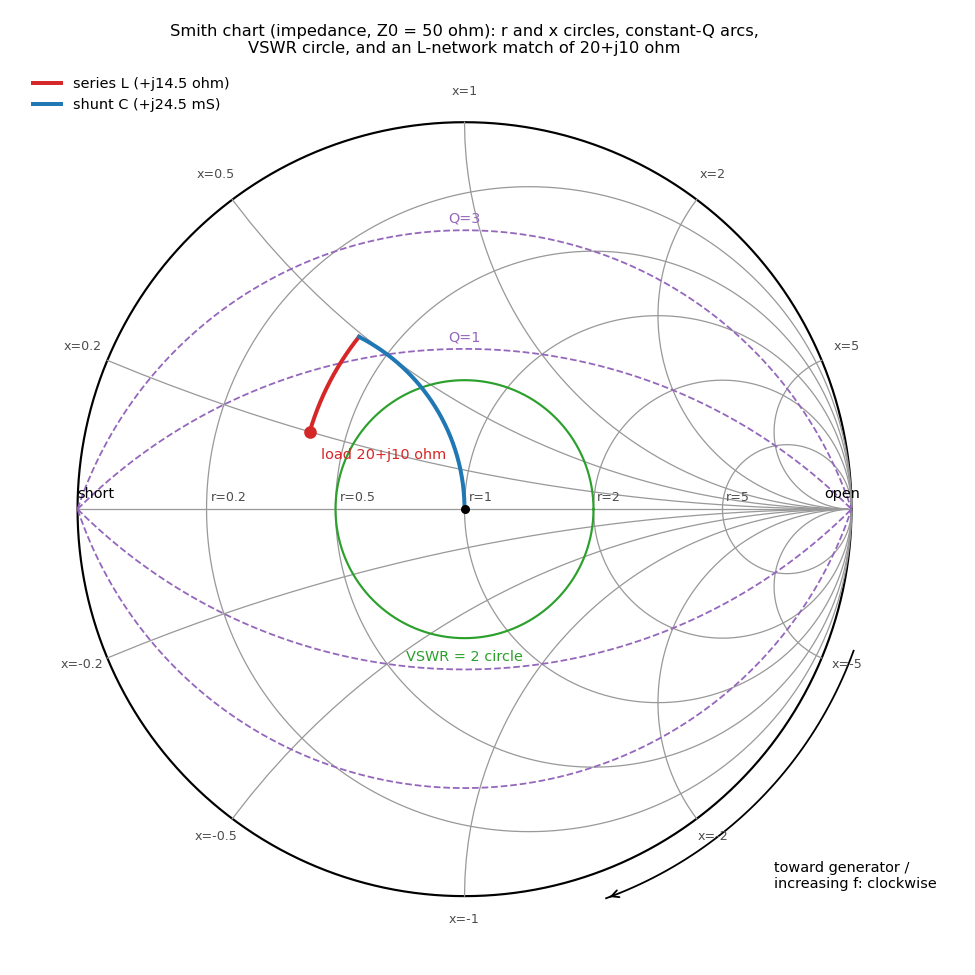

# The Smith chart



*Figure: impedance Smith chart (Z₀ = 50 Ω) with constant-r and constant-x circles, constant-Q arcs (Q = 1, 3), the VSWR = 2 circle, and an L-network match of 20 + j10 Ω (series L then shunt C). Generated by `tools/verify/tline_smith.py`.*

## Questions this page answers
- What exactly is the Smith chart — why are the grid lines circles?
- How do I read impedance, admittance, VSWR and Q off it?
- Which way do I move when I add a series inductor, a shunt capacitor, or a length of line?
- How do I read my NanoVNA's Smith display (markers, loops, spirals)?
- Why does the trace always go clockwise as frequency increases?
- What are constant-Q circles and why do they matter for bandwidth?
- What are noise, gain and stability circles (preview)?
- What does "negative resistance / outside the chart" mean?

## TL;DR
- The Smith chart is the complex **Γ-plane** (unit disk) with the **impedance** grid $z=Z/Z_0$ drawn on it via $\Gamma=(z-1)/(z+1)$. Centre = matched ($Z_0$); left end = short; right end = open; upper half = inductive; lower half = capacitive.
- Constant-$r$ lines map to circles centred $(\tfrac{r}{1+r},0)$ radius $\tfrac1{1+r}$; constant-$x$ lines to circles centred $(1,\tfrac1x)$ radius $\tfrac1{|x|}$. Distance from the centre is $|\Gamma|$ → concentric circles are constant VSWR.
- **Admittance chart** = same chart rotated 180° ($\Gamma_y=-\Gamma_z$). Overlaying both (the "Z-Y chart") lets you do series and shunt moves on one picture.
- Moves: **line toward generator** = clockwise rotation by $2\beta\ell$ (one full turn per λ/2) about the centre. **Series L** = clockwise along constant-r; **series C** = anticlockwise along constant-r; **shunt C** = clockwise along constant-g; **shunt L** = anticlockwise along constant-g.
- With increasing frequency every passive one-port's trace moves **clockwise** (Foster's reactance theorem). Long cables in front of the load wrap the trace into a clockwise spiral.
- **Constant-Q arcs** ($|x|/r=Q$) through the short and open points bound the loaded Q of an L-network: staying inside a low-Q arc = wider bandwidth.
- Lossless networks map the disk onto itself (Möbius disk automorphisms) and preserve the mismatch factor — that is why a lossless match can bring any passive point to the centre.

## Intuition (no math)
Impedances live on an infinite half-plane (resistance 0 to ∞, reactance −∞ to +∞), which is awkward to draw. The reflection coefficient, however, is always inside the unit circle for passive loads. Phillip Smith (1939) realised that if you plot Γ and then draw on top of it the lines along which resistance or reactance stays constant, you get a finite, complete map of *all* passive impedances. Lines of constant resistance become circles all touching the "open circuit" point on the right; lines of constant reactance become arcs also passing through that point.

The chart's power is that the things RF engineers do are *simple motions* on it. Adding line length only changes the phase of Γ, so it is a pure rotation about the centre. Adding a series reactance changes only $x$, so you slide along a resistance circle. Adding a shunt reactance changes only the susceptance, so you slide along a conductance circle of the admittance chart. Matching becomes a puzzle of "which arcs connect my load to the centre".

## The math

### Level 1 — reading the chart
- Normalise: $z=Z/Z_0=r+jx$, $y=1/z=g+jb$ (for $Z_0=50$ Ω, $g=G\times50$, $b=B\times50$).
- Plot $\Gamma=(z-1)/(z+1)$. $|\Gamma|$ = distance from centre; $\angle\Gamma$ measured anticlockwise from the right-hand axis.
- VSWR: where the constant-|Γ| circle crosses the right-hand real axis, read $r$ there — that $r$ *is* the VSWR (since at a voltage maximum $z=\text{VSWR}$).
- Outer scales: "wavelengths toward generator" (clockwise) and "toward load" (anticlockwise); a full turn = 0.5 λ.

### Level 2 — derivations

**The r and x circles.** Write $\Gamma=u+jv$. Inverting, $z=(1+\Gamma)/(1-\Gamma)$, so
$$r=\frac{1-u^2-v^2}{(1-u)^2+v^2},\qquad x=\frac{2v}{(1-u)^2+v^2}.$$
Rearranging the first gives $\left(u-\frac{r}{1+r}\right)^2+v^2=\left(\frac1{1+r}\right)^2$ — circles centred on the real axis, all passing through $(1,0)$. The second gives $(u-1)^2+\left(v-\frac1x\right)^2=\left(\frac1x\right)^2$ — circles centred on the vertical line $u=1$, tangent to the real axis at $(1,0)$. Verified to 10⁻¹² in the script for several $r$ and $x$.

**Admittance.** $y=1/z$ gives $\Gamma(y)=(y-1)/(y+1)=-(z-1)/(z+1)=-\Gamma$: the admittance grid is the impedance grid rotated 180°. Practical rule: to convert Z → Y on a plain chart, reflect the point through the centre.

**Constant Q.** For a series $r+jx$ the quality factor is $Q=|x|/r$ (same value for the equivalent parallel form, checked in the script). Put $z=r(1\pm jQ)$: the locus is an arc through $(\pm1,0)$ belonging to a circle centred $(0,\mp1/Q)$ with radius $\sqrt{1+1/Q^2}$ (the inductive, upper arc's circle is centred *below* the axis). Q arcs are used to choose L-network topologies and to estimate bandwidth: an L-network whose path stays under the $Q_n$ arc has loaded $Q\approx Q_n/2$ at a match ([matching](impedance-matching-lumped-and-distributed.md)).

**Moving along a line.** $\Gamma(d)=\Gamma_Le^{-2j\beta d}$ — clockwise rotation by $2\beta d$ ("toward generator"). A lossy line multiplies by $e^{-2\alpha d}$ as well: the point spirals inward toward the centre, which is the graphical form of "loss masks mismatch" ([reflections](reflections-vswr-return-loss-mismatch.md)).

**Series and shunt moves.** Adding series reactance $jX$ keeps $r$ fixed: motion along the constant-$r$ circle; increasing $x$ (series L) is clockwise about that circle's centre, decreasing (series C) anticlockwise. Adding shunt susceptance $jB$ keeps $g$ fixed: motion along the constant-$g$ circle (centre $(-g/(1+g),0)$ on the Γ plane); increasing $b$ (shunt C) is clockwise, decreasing (shunt L) anticlockwise. Mnemonic: *adding anything "more capacitive in shunt or more inductive in series" goes clockwise*. All four directions checked numerically.

**Frequency direction (Foster).** For any lossless one-port, $dX/d\omega>0$ and $dB/d\omega>0$ (Foster's reactance theorem), hence $\angle\Gamma$ decreases monotonically with frequency: traces move clockwise. The script checks a series RLC, a parallel LC and an open stub. For lossy one-ports the rule usually holds but small anticlockwise loops can appear near coupled resonances.

### Level 3 — the Smith chart as a Möbius map
- $\Gamma(z)=(z-1)/(z+1)$ is a **bilinear (Möbius) transformation** $w=(az+b)/(cz+d)$ with $ad-bc\neq0$. Such maps send circles-and-lines to circles-and-lines, are conformal (angle preserving: the r and x circles still cross at right angles, as the lines $r$ = const and $x$ = const do), and form a group under composition. Every standard operation is itself Möbius: a lossless two-port with ABCD matrix acts on $Z_L$ as $Z_\text{in}=(AZ_L+B)/(CZ_L+D)$; renormalising to a new reference $Z_0'$ is Möbius; so is the output-to-input map $\Gamma_\text{in}=S_{11}+S_{12}S_{21}\Gamma_L/(1-S_{22}\Gamma_L)$ of any two-port. That is *why* stability, gain and noise contours are circles on the chart.
- **Lossless networks are disk automorphisms.** A lossless two-port maps the unit disk onto itself; such maps preserve the quantity $\left|\dfrac{\Gamma_L-\Gamma_S^*}{1-\Gamma_S\Gamma_L}\right|$ and therefore the mismatch factor $M=\dfrac{(1-|\Gamma_S|^2)(1-|\Gamma_L|^2)}{|1-\Gamma_S\Gamma_L|^2}$ (the fraction of available power delivered) at every reference plane. The script confirms invariance to 10⁻¹⁵ through 200 random lossless ladders. Geometrically this is the Poincaré-disk picture of hyperbolic geometry: lossless matching networks are "rigid motions", so any point can be moved to the centre, but the *mismatch distance between source and load* cannot be changed without loss or gain.
- **Beyond |Γ| = 1.** Negative resistance (oscillator ports, some amplifier inputs) plots outside the unit circle; "compressed" Smith charts extend to |Γ| ≈ 3.16 for this reason.
- **Circles for amplifier design (preview).** For a two-port with $\Delta=S_{11}S_{22}-S_{12}S_{21}$, the *output stability circle* (loads where $|\Gamma_\text{in}|=1$) has centre $C_L=(S_{22}-\Delta S_{11}^*)^*/(|S_{22}|^2-|\Delta|^2)$ and radius $R_L=|S_{12}S_{21}|/\big||S_{22}|^2-|\Delta|^2\big|$ (verified by brute force in the script). Constant-gain, constant-noise-figure and constant-mismatch circles follow the same pattern. Unconditional stability: Rollett $K>1$ with $|\Delta|<1$, or equivalently Edwards–Sinsky $\mu>1$ — both introduced in [s-parameters](s-parameters.md) and applied in [LNA design](../06-rf-circuits/lna-design.md) and [amplifier stability](../06-rf-circuits/amplifier-stability-and-biasing.md).

## Design equations & rules of thumb

| Item | Formula / rule | Note |
|---|---|---|
| Point | $\Gamma=(z-1)/(z+1)$ | $z=Z/Z_0$ |
| r circle | centre $(r/(1+r),0)$, radius $1/(1+r)$ | all through (1,0) |
| x circle | centre $(1,1/x)$, radius $1/|x|$ | tangent to real axis at (1,0) |
| Q arc | centre $(0,\mp1/Q)$, radius $\sqrt{1+1/Q^2}$ | through short and open |
| Z → Y | rotate 180° | $\Gamma_y=-\Gamma_z$ |
| Line, toward generator | rotate clockwise by $2\beta\ell$ | 360° per λ/2 |
| Series L / C | clockwise / anticlockwise on constant r | |
| Shunt C / L | clockwise / anticlockwise on constant g | |
| Increasing frequency | clockwise (Foster) | spirals = cable delay |
| VSWR | $r$ at right-hand real-axis crossing of the |Γ| circle | |

## Worked examples

### Example 1 — reading a NanoVNA marker on a 433 MHz chip antenna
Marker at 433 MHz shows $Z=32.1-j18.5$ Ω (Smith R+jX format). Normalised $z=0.642-j0.370$; $\Gamma=(z-1)/(z+1)=0.306\angle{-121°}$ — lower half (capacitive), just inside the VSWR 2 circle (VSWR 1.88, RL 10.3 dB). In "R+L/C" format the NanoVNA would display 32.1 Ω and **19.9 pF** (series equivalent $C=-1/(\omega X)$); in G+jB format the parallel equivalent is 42.8 Ω ∥ 4.95 pF. Series and parallel forms share Q = 0.58. To match: $R<50$ Ω, so use series-then-shunt. $Q_n=\sqrt{50/32.1-1}=0.747$, target series reactance $\pm Q_nR=\pm24.0$ Ω. Solution A: add +j42.5 Ω (**15.6 nH** series) then shunt **5.49 pF**. Solution B: add −j5.5 Ω (**67 pF** series) then shunt **24.6 nH** (both verified to give exactly 50 Ω). Note that merely cancelling the −j18.5 Ω with 6.8 nH would leave 32.1 Ω (VSWR 1.56) — cancelling reactance is not matching. Procedure and component-Q effects: [matching page](impedance-matching-lumped-and-distributed.md).

### Example 2 — 25 Ω through λ/8 of 50 Ω line
$z_L=0.5$, $\Gamma_L=-1/3$. λ/8 toward the generator = 90° clockwise: $\Gamma=(-1/3)e^{-j\pi/2}=+j/3$ → $z=(1+j/3)/(1-j/3)=0.8+j0.6$ → **40 + j30 Ω**, identical to the input-impedance formula. On the chart you stay on the VSWR 2 circle the whole time.

### Example 3 — the L-network in the figure (915 MHz)
Load 20 + j10 Ω ($z=0.4+j0.2$). Since $R_L<Z_0$, add series reactance first to reach the $g=1$ circle, then shunt susceptance to the centre. L-network $Q_n=\sqrt{50/20-1}=1.225$; total series reactance $Q_nR_L=24.5$ Ω, of which 10 Ω exists, so add **+j14.5 Ω = 2.52 nH** (red arc, clockwise on r = 0.4); then shunt $B=Q_n/50=24.5$ mS = **4.26 pF** (blue arc, clockwise on g = 1). Note how the red/blue path stays below the Q = 1.225 arc.

### Example 4 — why is my antenna trace a spiral?
Measuring an antenna through 1 m of RG-58 (VF 0.66) from 400 to 470 MHz: the cable adds $2\beta\ell$ = 2 × 360° × 1/(0.66 × 0.692) ≈ 1576° of rotation at 433 MHz, changing by ≈ 2 × 360° × Δf × ℓ/v_p ≈ 255° over the 70 MHz sweep. The antenna's own small loop is smeared into a clockwise spiral that also shrinks slightly (cable loss). Fix: calibrate at the antenna end of the cable, or use the VNA's *electrical delay / port extension* to rotate the reference plane (subtract $2\ell/v_p$ ≈ 10.1 ns round-trip).

## Practical notes (NanoVNA / LiteVNA / LibreVNA)
- **Calibrate at the reference plane you care about** (SOL at the end of the cable or at the U.FL on the board). A calibration at the instrument port puts every cable, adapter and trace between you and the load into the plot. Practice belongs to [VNA calibration](../17-test-measurement/vna-fundamentals-calibration.md) and [NanoVNA practical](../17-test-measurement/nanovna-librevna-practical.md).
- **Marker formats**: NanoVNA firmware offers Smith "R+jX", "R+L/C" (series equivalent L or C at the marker frequency), "G+jB" (parallel) and polar/linear formats [4], [5]. The L/C reading is only meaningful at that single frequency.
- **What shapes mean**: a small loop (a "kink" that doubles back) near the centre usually indicates a resonance of the antenna plus a matching element — the loop's tightness around the centre sets the matched bandwidth. A trace hugging the outer rim = nearly lossless reactance (a bare stub, a capacitor). A trace collapsing toward the centre with frequency = loss (lossy cable, absorber).
- **Normalisation**: the chart is normalised to the instrument's reference impedance (50 Ω). Viewing a 75 Ω system on a 50 Ω chart shifts "matched" to $\Gamma=0.2$.
- **Don't trust dB-only plots** for matching: the phase (position on the chart) determines which component to add; an $S_{11}$ magnitude plot only tells you how far you are from the centre.

## Common mistakes & misconceptions
- **Rotating the wrong way.** Toward the generator (adding line between you and the load) = clockwise. Toward the load (de-embedding) = anticlockwise.
- **Mixing Z and Y moves.** Series elements → use the impedance (r, x) circles; shunt elements → use admittance (g, b) circles. On a plain Z chart, reflect through the centre before a shunt move and back afterwards.
- **Forgetting to normalise** (plotting 25 Ω as "r = 25").
- **Using "wavelengths" scales with the free-space wavelength** instead of the in-line wavelength (include VF).
- **Believing a clockwise-only rule is violated by a measurement**: an anticlockwise wiggle usually means the calibration reference plane is beyond the device (negative port extension), or a lossy coupled resonance.
- **"The Smith chart only works for lossless lines."** Loss is just an inward spiral; and all the circle constructions are exact for lumped elements.
- **"Points outside the circle are measurement errors."** Not if the device is active (negative resistance) — but for a passive antenna it does indicate a calibration problem.

## How to simulate / verify
- `tools/verify/tline_smith.py` — r/x circle geometry, admittance rotation, constant-Q circles, rotation direction for lines and for series/shunt L/C, Foster clockwise rule, conformality, marker conversions, stability-circle formula, and invariance of the mismatch factor through random lossless networks; generates the figure above. All pass.
- scikit-rf plotting:

```python
import skrf as rf, matplotlib.pyplot as plt
ant = rf.Network('antenna.s1p')          # NanoVNA-saved Touchstone file
ant['400-470mhz'].plot_s_smith(draw_labels=True)
ant_de = ant.delay(-10.1, 'ns')          # skrf's d is the round-trip delay for a 1-port: removes 1 m of VF 0.66 cable
plt.show()
```
- Interactive: `smithchart` tools such as QUCS-S, SimSmith (free, Java) and the online "Smith chart" by Fritz Dellsperger are handy for exploring moves.

## Open questions / gaps
- The hyperbolic-geometry interpretation is stated with a numerical check but without a textbook citation in this pass.
- Constant-gain and noise-circle formulas are only previewed; full treatment belongs in [LNA design](../06-rf-circuits/lna-design.md).

## Sources
1. P. H. Smith, "Transmission line calculator," *Electronics*, vol. 12, pp. 29–31, Jan. 1939; and P. H. Smith, *Electronic Applications of the Smith Chart*, McGraw-Hill 1969 (Noble reprint 1995). (original article / book)
2. D. M. Pozar, *Microwave Engineering*, 4th ed., Wiley 2012 — §2.4 (Smith chart, combined Z-Y chart), §5.1–5.3 (matching on the chart), §12.2–12.3 (stability, gain and noise circles; K–Δ and μ tests). (textbook)
3. G. Gonzalez, *Microwave Transistor Amplifiers: Analysis and Design*, 2nd ed., Prentice Hall 1997 — ch. 2–4 (Smith chart as bilinear map, circles, constant-Q). (textbook)
4. WA5OKO, *NanoVNA Vector Network Analyzer User Guide*, 2020 (community translation of the NanoVNA-H manual) — https://amris.mbi.ufl.edu/wordpress/files/2021/01/NanoVNA-User-Guide.pdf — trace/marker formats (SMITH R+jX, R+L/C, G+jB). (user manual)
5. PA3A, "Smith Chart in the nanoVNA — applications for the radio amateur," 2022 — https://pa3a.nl/wp-content/uploads/2022/07/Smith-Chart-in-the-nanoVNA-2022-july-ENGLISH.pdf — reading NanoVNA Smith displays. (tutorial)
6. M. L. Edwards and J. H. Sinsky, "A new criterion for linear 2-port stability using geometrically derived parameters," *IEEE Trans. MTT*, vol. 40, no. 12, pp. 2303–2311, Dec. 1992 — μ factor. (peer-reviewed)
7. R. M. Foster, "A reactance theorem," *Bell System Technical Journal*, vol. 3, pp. 259–267, 1924 — monotonic reactance of lossless one-ports. (peer-reviewed)
8. Verification: `tools/verify/tline_smith.py`. (numerical check)
