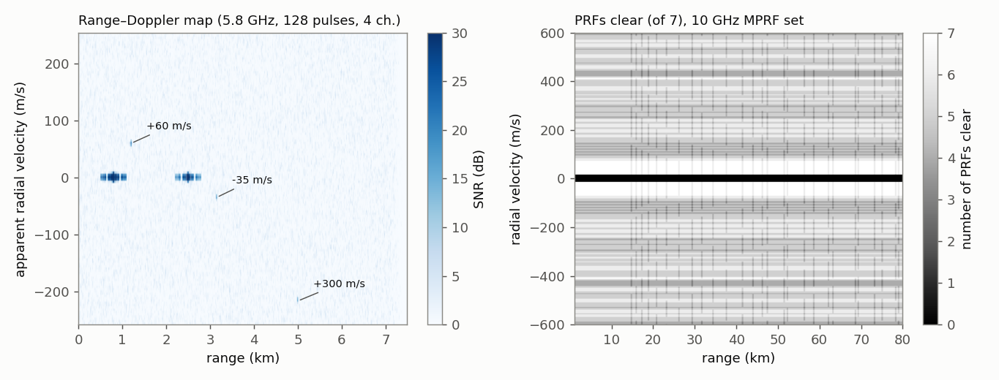

# Pulse-Doppler processing: the data cube and PRF regimes

## Questions this page answers
- What is the radar "data cube", and what are fast time and slow time?
- How do I turn a stack of received pulses into a range–Doppler map?
- How much SNR do pulse compression, the Doppler FFT and the antenna channels each give me?
- What are low-, medium- and high-PRF radars, and why does each one exist?
- What are eclipsing and blind zones, and how much do they cost?
- How does a radar with several PRFs resolve range and velocity ambiguities (Chinese remainder theorem)?
- Why does exact CRT fail with noisy measurements, and what do real radars do instead?
- What is a moving-target detector (MTD) and which Doppler window should it use?
- How do I run CFAR on a range–Doppler map, and does windowing upset the false-alarm rate?
- How long can I integrate coherently on an accelerating rocket?
- Can I build a pulse-Doppler radar with an SDR, and what would it see?
- How big is the data cube and how much processing does it take?
- Is an FMCW chirp-sequence radar a pulse-Doppler radar?

## TL;DR
- **The data cube** is the receiver output indexed by **fast time** (range samples within one PRI, rate f_s), **slow time** (pulse number, rate PRF) and **channel** (antenna element). Processing is a sequence of 1-D operations along each axis: matched filter (range), FFT (Doppler), beamforming (angle), then CFAR on the range–Doppler map. An FMCW chirp-sequence radar fills exactly the same cube ([FMCW](fmcw-radar.md)).
- **Gains** (verified by simulation, 4 × 128 × 1000 cube): the matched filter gives the number of samples in the pulse (τf_s; equal to TB when SNR is referred to bandwidth B), the Doppler FFT gives N (minus the window loss, 1.84 dB for Chebyshev-60), and coherent beamforming gives M. A non-coherent sum over channels raises the *mean* SNR by nothing: it only steadies detection. Measured: 40.8 dB coherent vs 41.3 predicted; 34.8 dB non-coherent vs 35.3.
- **PRF regimes** (X-band, MIT LL course [1]): **low PRF 1–3 kHz** (≈ 0.5% duty), range unambiguous, Doppler highly ambiguous (v_u = ±7.5–22.5 m/s). **Medium PRF 10–30 kHz** (≈ 5%), both ambiguous, resolved with 7–8 PRFs. **High PRF 100–300 kHz** (< 50% duty), Doppler unambiguous (±750–2250 m/s), range highly ambiguous (R_u 0.5–1.5 km). The constant R_u·v_u = cλ/8 forbids having both.
- **Eclipsing**: a target at random range loses on average **−10 log(1 − d)** of echo energy (duty d): 0.22 dB at 5%, **1.87 dB at 35%**, 3.0 dB at 50%. This matches MIT LL's "1–2 dB if unmitigated" for HPRF.
- **Multiple PRFs**: a 7-PRF medium-PRF set (5.75–10.25 kHz at 10 GHz, ±15 m/s clutter notch) leaves ≥ 3 PRFs clear over **97.5%** of 1–80 km × ±600 m/s. Exact **CRT** unfolds perfect residues, but with σ = 0.1 / 0.25 cell measurement noise it is right only 84 / 59% of the time. A **coincidence (clustering) search** gets 99.8 / 72%.
- **Doppler filter bank (MTD)**: with 8 pulses, a **40 dB Chebyshev window is optimal** (median clutter improvement 40.8 dB vs 31.6 rect and 30.9 for 60 dB, whose main lobe is too wide). This is consistent with ASR-9's 40 dB Doppler sidelobes [2]. With 16 pulses, 60 dB gives 63 dB.
- **CPI limit for acceleration**: Doppler moves one bin when T = **√(λ/(2a))**: 16.2 ms for a 10 g rocket at 5.8 GHz. The loss is 0.24 dB at T_max, 4.0 dB at 2T_max and 7.7 dB at 3T_max.
- **DIY**: a 100 mW, 1 µs, 20 kHz-PRF SDR radar integrates only 25.6 µJ per 12.8 ms CPI. That gives −16.7 dB SNR on a 0.01 m² drone at 1 km. A 10 W PA, 4 µs pulses and 1024 pulses reach 15.4 dB, but the blind range is then 750 m. Short-range hobby radars use FMCW for this reason.

## Intuition (no math)

**A spreadsheet of echoes.** Each time the radar fires a pulse it records a row of samples: sample 1 is the echo from very close, sample 1000 from far away. That row is "fast time", because it fills in microseconds. Fire 128 pulses and stack the rows: down each column you see the *same range* revisited every PRI. That direction is "slow time", milliseconds. With four antennas you get four such sheets: the data cube.

**Each axis answers one question.** Along a row, a matched filter squeezes each long, coded pulse into a sharp spike, which gives range. Down a column, a stationary target gives the same number every time, while a moving one rotates in phase from pulse to pulse. An FFT down the column turns that rotation into a frequency, which gives Doppler and hence velocity. Across the four sheets, the phase differences between antennas give angle. Then you look for bright cells that stand out from their neighbours (CFAR).

**The PRF dilemma.** Sampling motion pulse-to-pulse is like filming a spinning wheel: fire too slowly and fast targets alias, like wagon wheels turning backwards. Fire fast enough to see fast targets unambiguously, and the next pulse leaves before echoes from far targets come back, so a far echo masquerades as a near one. You can't have both. Air-to-air radars choose a compromise PRF and then switch between several PRFs, solving the ambiguity like a puzzle: the true range must be consistent with what each PRF saw.

**Blindness comes in two kinds.** A monostatic radar is deaf while it transmits. Echoes that arrive then are lost ("eclipsed"), and at high PRF a big fraction of ranges is eclipsed some of the time. And the clutter filter that removes the ground also removes any target whose Doppler happens to alias onto zero ("blind speed"). Several PRFs move both kinds of blind spot around, so a target is visible in at least a few.

**Coherent time is limited by how steady the target is.** Integration only works while the target keeps a constant Doppler. A rocket under thrust changes speed, so after a few tens of milliseconds its echo has slid into the next Doppler bin and further integration smears instead of adding.

## The math

Conventions: e^{+jωt}; radial velocity v positive approaching, giving Doppler f_d = 2v/λ > 0; PRI T_r = 1/PRF; pulse τ, bandwidth B, complex sampling f_s; N pulses per coherent processing interval (CPI), M channels at spacing d. ([Pulsed radar](pulsed-radar-and-pulse-compression.md) has resolution, PRF and pulse-compression basics; [clutter & MTI](clutter-and-mti.md) has cancellers and blind speeds.)

### Level 1 — the cube and the regimes

$$x[m,p,n] = a\;s(nT_s-\tau_0)\;e^{-j4\pi R_p/\lambda}\;e^{\,j2\pi (d/\lambda)m\sin\theta} + \text{noise},\qquad R_p = R_0 - vpT_r,$$
with m = channel (0…M−1), p = pulse (slow time, 0…N−1), n = range sample (fast time, 0…f_sT_r − 1), and τ₀ = 2R₀/c.

| Axis | Operation | Resolution | Ambiguity |
|---|---|---|---|
| fast time n | matched filter / pulse compression | ΔR = c/(2B) | R_u = cT_r/2 |
| slow time p | windowed FFT | Δv = λ/(2NT_r) | v_u = ±λ·PRF/4 |
| channel m | beamforming FFT / DOA | ≈ λ/(Md) rad | grating lobes if d > λ/2 |

| Regime (X-band, [1]) | PRF | Duty | Range | Doppler | Typical use |
|---|---|---|---|---|---|
| Low PRF | 1–3 kHz | ≈ 0.5% | unambiguous (R_u 50–150 km) | highly ambiguous (±7.5–22.5 m/s) | search, ground mapping, MTI; long range |
| Medium PRF | 10–30 kHz | ≈ 5% | ambiguous (R_u 5–15 km) | ambiguous (±75–225 m/s) | fighter look-down; 7–8 PRFs, M-of-N |
| High PRF | 100–300 kHz | < 50% | highly ambiguous (0.5–1.5 km) | unambiguous (±750–2250 m/s) | head-on detection of fast closers in clutter-free Doppler |

(Our numbers from v_u = λPRF/4 and R_u = c/(2PRF) at 10 GHz; at 5.8 GHz multiply v_u by 1.72. UHF airborne early warning uses ≈ 300 Hz low PRF [1].)

### Level 2 — derivations

**(a) Range, Doppler and angle as three Fourier-type operations.** For fixed m and p, matched filtering along n gives the autocorrelation of s centred at n₀ = τ₀f_s. Its peak is the sum of the pulse samples: with per-sample SNR defined at f_s, the gain is the number of samples **τf_s** (= TB·f_s/B). Referred to bandwidth B (noise in B only) it is the familiar TB [3]. Along p, the phase −4πR_p/λ = const + 2π(2v/λ)pT_r is a complex exponential at f_d = 2v/λ. The N-point DFT concentrates it into one bin (gain N; window w costs the taper loss |Σw|²/(NΣw²)). The bin index is f_d modulo PRF, so velocity is ambiguous outside ±λPRF/4. Along m, the phase 2π(d/λ)m sinθ is a spatial frequency, and coherent beamforming adds M. **Coherent gains multiply: τf_s·N·M.** A non-coherent sum of |·|² over channels adds signal and noise powers alike. It does not improve mean SNR, though it lowers the SNR needed for a given P_D by averaging the fluctuations ([detection](detection-theory-cfar.md)). Verified (§1, LFM 10 MHz/2 µs at f_s = 20 MHz, N = 128, M = 4, Chebyshev-60 Doppler window, an on-grid target): measured 40.8 dB coherent (predicted 41.3) and 34.8 dB non-coherent (35.3). Off-grid targets lose up to the range straddle (≤ 0.93 dB at 2 samples per 1/B) and the Doppler scalloping loss (rect 3.92, Hamming 1.72, Chebyshev-60 1.39 dB at half a bin).

**(b) Range migration and the CPI.** Over a CPI the target moves vNT_r. Keep that below a range cell (vNT_r < c/(2B)) or "keystone"-correct it. A 300 m/s rocket in a 12.8 ms CPI moves 3.8 m, well inside 15 m. Acceleration a makes the slow-time phase quadratic: φ(t) = (4π/λ)(vt + ½at²). The Doppler drifts by aT, and one Doppler bin is λ/(2T), so drift equals one bin when
$$aT = \frac{\lambda}{2T}\ \Rightarrow\ T_{max} = \sqrt{\frac{\lambda}{2a}},$$
where the quadratic phase at the CPI ends is (4π/λ)·½a(T/2)² = π/4. Coherent loss (best Doppler filter, §8): 0.01 dB at ½T_max, **0.24 dB at T_max**, 4.0 dB at 2T_max, 7.7 dB at 3T_max. Numbers: 10 g at 5.8 GHz → 16.2 ms; 5 g → 23.0 ms; 10 g at 10 GHz → 12.4 ms; a car braking at 1 g seen by 77 GHz radar → 14.1 ms. For longer dwells, compensate the acceleration (a bank of chirped Doppler filters, or use the tracker's acceleration estimate; [tracking](radar-tracking-monopulse-and-trackers.md)).

**(c) Eclipsing.** The receiver is blind for the transmit time τ (plus T/R recovery) in every PRI. An echo of length τ arriving at a random time within the PRI has each of its parts received with probability 1 − d (d = τ/T_r). So the **mean received energy fraction is 1 − d and the average eclipsing loss is −10 log₁₀(1 − d)**. Verified (§3): 1% → 0.04 dB, 5% → 0.22, 10% → 0.46, 35% → 1.87, 50% → 3.01 dB. With a fixed full-length matched filter the loss of a partially eclipsed echo grows faster (SNR ∝ fraction²): 2.73 dB at 35%. The fraction of ranges partially eclipsed is ≈ 2d (70% at 35% duty). Remedies: change PRF between CPIs (the eclipsed ranges move), use a shorter compressed pulse, or use separate TX/RX antennas.

**(d) Blind zones and M-of-N PRF sets [1], [4].** For each PRF the radar is blind (i) in range wherever the echo overlaps the transmit/recovery window, i.e. at multiples of R_u; and (ii) in velocity wherever the aliased Doppler f_d mod PRF falls in the clutter notch. A target is declared only if detected in at least M of the N PRFs, which both resolves the ambiguities and gives false-alarm control. MIT LL's APG-66-style example uses 7 PRFs from 5.75 to 10.25 kHz [1]. Our blind-zone map (§4: 10 GHz, τ = 1 µs + 0.5 µs recovery, ±15 m/s notch): each PRF alone is clear over 98.2% of ranges but only 74.0% of velocities, and the set gives **≥ 3 of 7 clear over 97.5%** (≥ 4 of 7: 96.3%) of 1–80 km × ±600 m/s. The residue is |v| < 15 m/s: blind in every PRF because the notch is at true zero Doppler. A low-PRF mode or MTI on a different axis (angle, range-rate history) is needed there.

**(e) Chinese remainder theorem [1], [5].** Express the true range in units of the range cell, n, and choose PRFs whose unambiguous intervals are m₁, m₂, … cells, pairwise coprime. Each PRF measures the residue a_i = n mod m_i. The CRT says n is unique modulo Πm_i and gives it constructively:
$$n = \Big(\sum_i a_i M_i b_i\Big)\bmod \prod_i m_i,\qquad M_i = \frac{\prod_j m_j}{m_i},\quad b_i = M_i^{-1}\bmod m_i .$$
Example: m = 7, 8 (range unambiguous to 56 cells), true cell 45 → residues 3, 5. M₁ = 8, b₁ = 8⁻¹ mod 7 = 1; M₂ = 7, b₂ = 7⁻¹ mod 8 = 7. So n = (3·8·1 + 5·7·7) mod 56 = (24 + 245) mod 56 = 269 mod 56 = 45 ✓ (§5a; 11/12/13 cells → 1716 cells, §5b). **CRT is fragile**: a one-cell error in any residue maps to a completely different n, because the modular arithmetic has no notion of "close". With Gaussian residue errors of σ = 0.1/0.25/0.4 cell (3 PRFs 11/12/13), exact CRT on rounded residues is right 83.8/59.2/35.8% of the time. A **coincidence search**, which unfolds one PRF's measurement over all candidates and picks the one whose unfoldings in the other PRFs agree in the least-squares sense (the "clustering" approach of practical radars [6]), is right 99.8/72.5/40.4%. Velocity is unfolded the same way. Two PRFs of 20 and 23 kHz at 5.8 GHz resolve 140 m/s from apparent values, with an unambiguous span of 11.9 km/s (§5d).

**(f) Doppler filter banks and the MTD [2], [7].** The **moving-target detector** (Lincoln Laboratory, ASR-9) replaces the single MTI canceller by a bank of N Doppler filters per range cell (8 pulses in the ASR-9), followed by a zero-velocity filter with a clutter map and per-cell adaptive thresholds. Clutter improvement for filter k = |Σw|² / ∫S_c(f)|H_k(f)|²df (target at the filter centre, Gaussian clutter spectrum). For σ_v = 0.3 m/s, 3 GHz, 1 kHz PRF (§6), the median over filters 1…N−1 is:

| Window | N = 8 | N = 16 |
|---|---|---|
| rect | 31.6 dB | 31.8 dB |
| Hamming | 25.7 dB | 46.9 dB |
| Dolph–Chebyshev 40 dB | **40.8 dB** | 49.1 dB |
| Dolph–Chebyshev 60 dB | 30.9 dB | **63.1 dB** |

With 8 pulses a 60 dB window's main lobe spans several bins, so clutter leaks through the main lobes of the near filters. The best design is a **moderate (≈ 40 dB) window for short CPIs** and very low sidelobes only when N is large. ASR-9 specified 40 dB Doppler sidelobes [2]. The filters adjacent to zero are always clutter-limited (6–26 dB). The three-pulse canceller reaches ≈ 60 dB average for the same clutter ([clutter & MTI](clutter-and-mti.md)), which is why MTD-type processors put an MTI or zero-filter stage in front of, or alongside, the bank.

**(g) CFAR on the range–Doppler map.** 2-D CA-CFAR estimates the noise from a rectangular ring of N_ref cells around the cell under test, with guard cells excluding the target's own spread. α = N_ref(P_fa^{−1/N_ref} − 1) gives P_fa = (1 + α/N_ref)^{−N_ref} for i.i.d. exponential cells ([detection](detection-theory-cfar.md)). Measured on noise-only maps (§7, 126 reference cells): rect window, design 10⁻³/10⁻⁴ → 1.00×10⁻³/0.88×10⁻⁴. With a **Hamming Doppler window** neighbouring cells are correlated, so the reference average has fewer effective degrees of freedom: 1.11×10⁻³/1.21×10⁻⁴, i.e. +11% and +21%. The effect grows at lower P_fa, so recalibrate α empirically on recorded noise. In the cube simulation, strong stationary scatterers (25 dB per sample) also produced zero-Doppler CFAR hits up to **±300 m (= cτ/2) around each scatterer**: the range sidelobes of the unweighted LFM. Apply range weighting and a zero-Doppler notch (or clutter map) before CFAR.



**(h) Processing chain as code** (pseudocode of the chain implemented in `e8_pulse_doppler.py` §1):
```python
# cube[m, p, n]: channel x pulse x fast-time (complex baseband)
rc  = matched_filter_along_n(cube, pulse_replica)          # pulse compression, per (m, p)
rc *= range_weight? (Taylor) ; subtract mean over p?        # optional: range sidelobes, zero-Doppler notch
RD  = fftshift(fft(rc * w[None, :, None], axis=1), axes=1)  # Doppler FFT along slow time (window w)
P   = sum(|RD|**2, axis=0)            # non-coherent over channels (detection)  -- or --
B   = tensordot(conj(a(theta)), RD, axes=(0, 0))            # coherent beam toward theta (+10 log M)
det = cfar2d(P, guard=(2, 2), train=(8, 4), pfa=1e-6)       # 2-D CA-CFAR on the range-Doppler map
for (kd, kr) in local_maxima(det):                          # angle per detection from RD[:, kd, kr]
    theta_hat = argmax_theta |a(theta)^H RD[:, kd, kr]|
```
Velocity sign convention: with e^{+jωt} and an approaching target, the slow-time phase advances, so f_d > 0. TI FMCW data shows approaching targets at negative Doppler because of its own conjugation convention ([FMCW](fmcw-radar.md)).

**(i) Size and throughput of the cube.** Samples per CPI = M·N·f_sT_r. Example 1: 4 × 128 × 1000 = 512 k complex (3.9 MiB at complex64), every 6.4 ms, i.e. 80 M complex samples/s through the processor. Per CPI the work is M·N matched filters of length f_sT_r (FFT-based ≈ 2·5·n log₂n flops each) plus M·n Doppler FFTs of length N. Roughly 0.15–0.3 GFLOP per CPI here, or ≈ 25–50 GFLOP/s (order-of-magnitude estimate): a desktop CPU with numpy can do it offline, and real time needs a GPU or FPGA. This is the practical reason SDR radars record raw I/Q and process afterwards.

| | Pulsed (pulse-Doppler) | FMCW chirp sequence |
|---|---|---|
| Fast-time processing | matched filter of the pulse | dechirp + range FFT |
| Slow-time sampling | PRF | chirp repetition rate |
| Duty / energy | d = τ·PRF (≈ 0.5–50%) | ≈ 100% (energy = P·T_CPI) |
| Blind range | c(τ + t_rec)/2 | none; TX→RX leakage instead |
| Range ambiguity | R_u = c/(2PRF) | set by IF bandwidth / ADC rate |
| Typical builder hardware | SDR + PA + T/R switch, coherent | TI/Infineon radar chips, SDR + VCO |
| Best at | long range, high peak power | short range, low power |

### Level 3 — beyond the ground-based case
- **Airborne pulse-Doppler**: platform motion spreads main-lobe and sidelobe clutter over ±2v_p/λ. Medium/high PRF fold sidelobe clutter across the whole Doppler band, so antenna sidelobes must be very low. Look-down detection then needs STAP ([clutter & MTI](clutter-and-mti.md) Level 3; [adaptive beamforming](../12-phased-arrays/adaptive-beamforming-doa.md)).
- **HPRF ranging**: with range ambiguous by 100×, HPRF radars range by FM-ranging (linear FM across the dwell) or by three PRFs [1].
- **PRF-set design** is an optimisation over visibility, ambiguity span, ghost rate and dwell time (Long et al. on the APG-66 [4]; Oxford/Thales study-group problem 2011 — the inverse design problem remains hard).
- **FMCW chirp-sequence = pulse-Doppler at 100% duty**: the "pulse" is the chirp, the PRI is the chirp period, the cube and processing are identical. The waveform's continuous energy is why automotive and hobby radars use it ([FMCW](fmcw-radar.md), [MIMO](mimo-radar-virtual-arrays.md)).
- **Track-before-detect / long-dwell** methods integrate across CPIs along hypothesised trajectories, beating the acceleration limit at the cost of computation.

## Design equations & rules of thumb

| Equation / rule | When valid | Typical values (verified) |
|---|---|---|
| Coherent gain = τf_s · N · M (per-sample SNR at f_s); TB·N·M referred to B | matched filter + FFT + beamformer | 40 samples × 128 × 4 → 43.1 dB (−1.84 dB window) |
| Non-coherent channel sum: no mean-SNR gain | |·|² summed over channels | 34.8 vs 35.3 dB (no ×M) |
| R_u v_u = cλ/8 | any PRF | 1.12×10⁶ m²/s at 10 GHz |
| Eclipsing loss = −10 log(1 − d) | random range, energy-matched | 35% → 1.87 dB |
| Partially eclipsed ranges ≈ 2d | d < 0.5 | 35% → 70% |
| CRT: n = Σa_iM_ib_i mod Πm_i | coprime intervals, perfect residues | 7, 8 → 56 cells |
| Noisy residues → coincidence search | σ ≳ 0.1 cell | σ = 0.1: 99.8% vs CRT 84% |
| T_max = √(λ/(2a)) | accelerating target | 10 g, 5.8 GHz: 16.2 ms |
| Range migration: vNT_r < c/(2B) | long CPI, fast target | 300 m/s × 12.8 ms = 3.8 m |
| MTD window: ≈ 40 dB for N = 8; 60 dB for N ≥ 16 | Gaussian clutter σ_v 0.3 m/s | 40.8 / 63.1 dB median |
| Doppler scalloping (half bin) | FFT filter bank | rect 3.92, Hamming 1.72, Cheb-60 1.39 dB |
| CA-CFAR α = N(P_fa^{−1/N} − 1) | i.i.d. cells | correlated (windowed) cells: P_fa +10–20% |

## Worked examples

**Example 1 — Walking through a cube (5.8 GHz, the §1 simulation).** LFM 10 MHz over 2 µs (TB = 20), f_s = 20 MHz, PRF 20 kHz (1000 samples per PRI), N = 128 pulses (CPI 6.4 ms), M = 4 channels at λ/2. The cube is 512 k complex samples (3.9 MiB in complex64). ΔR = 15 m, Δv = 4.04 m/s, R_u = 7.49 km, v_u = ±258 m/s. Three targets, at −12/−15/−18 dB SNR per sample (invisible in the raw data), are detected at 1199.2 m/+60.6 m/s/+10.6°, 3147.8 m/−36.3 m/s/−20.1° and 4999.0 m/**−218.1 m/s**/+1.6°. The last target truly moves at +300 m/s and appears at 300 − 2·258.4 = −216.8 m/s: an aliased velocity that a second PRF must unfold. Output SNRs are 17–23 dB after the non-coherent channel sum, 6 dB more with a beam formed on the target.

**Example 2 — Choosing a regime for a 10 GHz radar watching a launch range.** Targets out to 50 km, speeds to ±600 m/s. Low PRF 3 kHz: range clean (R_u 50 km), but 27 Doppler ambiguity intervals; fine for detection and MTI, useless for measuring velocity. High PRF 100 kHz: velocity clean (±750 m/s), but 34 range ambiguities and ≈ 1–2 dB eclipsing at high duty. Medium PRF 10 kHz: 4 range × 9 velocity ambiguities; with a 7-PRF set, ≥ 3 clear over 97.5% of space. Ground-based with modest clutter, the usual answer is **low PRF plus a tracker for velocity**. Add a short high-PRF burst on a tracked target if you need its Doppler unambiguously.

**Example 3 — Unfolding a rocket's Doppler with two PRFs.** 5.8 GHz, PRFs 20 and 23 kHz (v_u ±258 and ±297 m/s). A rocket at 340 m/s (above both): apparent velocities 340 − 516.8 = −176.8 m/s and 340 − 594.3 = −254.3 m/s. Unfold the first by k·516.8 and the second by j·594.3, and look for the candidate pair that agrees: k = j = 1 gives 340.0 for both. The unambiguous span is λ·lcm(PRF₁, PRF₂)/2 = 11.9 km/s, far beyond any amateur rocket. With measurement noise, accept the candidate with the smallest disagreement and require the third PRF (M-of-N) to confirm.

**Example 4 — A DIY 5.8 GHz SDR pulse-Doppler radar: does it see anything?** Baseline: B210-class SDR with a 100 mW (20 dBm) PA, 18 dBi TX and RX patch arrays (separate antennas), NF 6 dB, 6 dB losses, LFM 10 MHz/1 µs, PRF 20 kHz, 256 pulses (CPI 12.8 ms; Δv 2.0 m/s; R_u 7.5 km; v_u ±258 m/s; duty 2%; blind range ≈ 300 m with 1 µs T/R recovery). It streams 20 MS/s complex (80 MB/s at 16-bit I/Q, USB 3 only; a Pluto on USB 2 cannot sustain it; [SDR survey](../14-sdr-dsp/sdr-hardware-survey.md)). Radar equation, energy form ([range equation](radar-range-equation.md)): the energy per CPI is 0.1 W × 1 µs × 256 = **25.6 µJ**. Integrated SNR for σ = 0.01 m² (small drone, or a −20 dBsm rocket body): **−4.6 dB at 500 m, −16.7 dB at 1 km**. Pd 0.9 / Pfa 10⁻⁶ needs ≈ 13.2 dB, so the baseline is ~30 dB short.

| Design | Energy/CPI | Drone 0.01 m² @ 1 km | Same RCS @ 2 km | Blind range |
|---|---|---|---|---|
| Baseline 0.1 W, 1 µs, 256 pulses | 25.6 µJ | −16.7 dB | −28.7 dB | 300 m |
| B: 10 W PA, 4 µs (TB 40), 1024 pulses (51 ms) | 41 mJ | **15.4 dB** | 3.3 dB | 749 m |
| C: 10 W, 10 µs (TB 100), 1024 pulses | 102 mJ | 19.4 dB | 7.3 dB | 1649 m |
| FMCW, 0.1 W continuous, 12.8 ms | 1.28 mJ | 0.3 dB | −11.7 dB | none (leakage-limited) |

Design B sees the drone, but it is blind inside 750 m. Its 51 ms CPI is 3.2 × T_max for a 10 g rocket (≈ 7.7 dB acceleration loss), so a small accelerating rocket at 2 km is out of reach. A rocket is a job for a transponder or a beacon, or for a corner reflector on board plus a CW Doppler radar, not for skin tracking ([DIY radar hardware](diy-radar-hardware.md), [RCS](radar-cross-section.md)). The general lesson: **at short range, pulsed radars are limited by duty cycle**, since energy needs long pulses and long pulses need long blind ranges. FMCW wins because it transmits all the time.

**Example 5 — Eclipsing budget for a 35% duty HPRF mode.** Average loss 1.87 dB for a random range (energy-matched processing), 2.73 dB with a fixed full-length matched filter, and 70% of ranges partially eclipsed. Cycling three PRFs moves the eclipsed ranges, so the loss after "best of three" is much smaller (not simulated here).

**Example 6 — Three-PRF CRT by hand.** Unambiguous intervals of 11, 12 and 13 range cells (span 1716 cells). A target in cell 1234 shows residues a = (2, 10, 12). M = (156, 143, 132), and the inverses b = (156⁻¹ mod 11, 143⁻¹ mod 12, 132⁻¹ mod 13) = (6, 11, 7). Then n = 2·156·6 + 10·143·11 + 12·132·7 = 28 690, and 28 690 mod 1716 = **1234** ✓. Now let the 13-cell PRF misread by one cell (residue 11): the same arithmetic gives n = 28 690 − 924 = 27 766 mod 1716 = 310, a ghost almost 1000 cells away. That fragility is why practical radars use the coincidence search with a tolerance (§(e)).

*Design procedure for a pulse-Doppler mode:*
1. From the maximum velocity, choose a PRF for unambiguous Doppler (PRF ≥ 4v_max/λ) or accept ambiguity and plan unfolding (PRF set, tracker).
2. From the maximum range, check R_u = c/(2PRF). If R_u < R_max, plan a CRT/coincidence PRF set (coprime intervals, span ≥ R_max) and M-of-N detection.
3. Pick B for ΔR, and τ for energy, subject to the blind range c(τ + t_rec)/2 and the eclipsing loss −10 log(1 − d).
4. Pick N for the velocity resolution λ/(2NT_r) and the integration gain, subject to T = NT_r ≤ √(λ/(2a)) and vT < ΔR.
5. Check the energy-form SNR (Pt·τ·N, gains, RCS, R⁴) against the required detection SNR ([detection](detection-theory-cfar.md)).
6. Choose the Doppler window (≈ 40 dB for N ≈ 8, lower sidelobes for larger N) and the CFAR geometry (guard cells ≥ the target's range/Doppler spread).

## Practical notes
- **Coherence first**: the whole cube relies on pulse-to-pulse phase stability. Lock TX and RX to one reference and keep the SDR's TX/RX timestamps aligned (a phase step between pulses spreads clutter over all Doppler bins). Record a loop-back pulse each CPI to check.
- **Store the cube as [channel][pulse][range]** (or chirp-major for FMCW) and do the FFTs in place. Range FFT/MF first, then Doppler; corner-turn memory is the cost in FPGAs ([FPGA for SDR](../14-sdr-dsp/fpga-for-sdr.md)).
- **Clutter before CFAR**: notch or map zero Doppler, weight the range compression (Taylor/Hamming) and use a moderate Doppler window. Otherwise strong stationary returns raise false alarms through their range sidelobes (seen in §1).
- **Calibrate α on real noise**: windowing, ADC quantisation and spurs change the realised P_fa. Record noise-only CPIs at the site.
- **Velocity ambiguity is a feature in tracking**: a tracker that knows range-rate from successive ranges can unfold Doppler from a single PRF ([tracking](radar-tracking-monopulse-and-trackers.md)).
- **Choose CPI by physics, not memory**: T ≤ √(λ/(2a)) for accelerating targets, and vNT_r < ΔR for range walk.

- **Ghost management**: in M-of-N schemes, require the unfolded ranges/velocities from different PRFs to agree within a tolerance of about one cell, and pass the survivors to the tracker, which kills the remaining ghosts by kinematic consistency.
- **Second-time-around clutter**: in a low-PRF radar, strong clutter from beyond R_u (mountains, rain) folds into near range. Pulse-to-pulse PRF jitter or a coherent transmitter with constant PRF within the CPI (the MTD approach [2]) keeps it at zero Doppler, where it can be notched.
- **Record a "dead" CPI**: transmit off, receiver on. This gives the noise and spur floor of the actual hardware for CFAR calibration.

## Common mistakes & misconceptions
- **"Summing four channels non-coherently gives +6 dB."** It gives no mean-SNR gain (34.8 vs 35.3 dB predicted without ×M). Only coherent beamforming adds 10 log M.
- **Quoting TB as the compression gain while defining SNR per sample at f_s > B.** The gain in those units is τf_s (3 dB more here); be consistent.
- **"High PRF is just better."** It trades range ambiguity and eclipsing (≈ 1–2 dB at 35% duty, 70% of ranges partially eclipsed) for Doppler clarity.
- **Exact CRT on noisy measurements**: a one-cell error gives a wildly wrong range (59% correct at σ = 0.25 cell). Use coincidence/clustering with a tolerance and an M-of-N rule.
- **The lowest-sidelobe window is always best.** With 8 pulses a 60 dB Chebyshev is worse (30.9 dB) than a 40 dB one (40.8 dB).
- **Integrating as long as memory allows on an accelerating rocket**: beyond √(λ/(2a)) the gain stops growing (−4 dB at 2T_max).
- **Assuming textbook CFAR P_fa after windowing**: correlated cells shift it by 10–20%.
- **Thinking an SDR + 100 mW makes a useful pulsed radar**: 25.6 µJ per CPI does not reach a drone at 1 km. Count joules, not watts.
- **Exact CRT with one bad residue**: a single one-cell error moved a cell-1234 target to cell 310 (Example 6).
- **Sizing the guard band too small in 2-D CFAR**: a target's own range sidelobes (±cτ/2 for unweighted LFM) and Doppler leakage enter the reference cells and raise the threshold (self-masking).
- **Forgetting the zero-Doppler blind zone** of every PRF: slow targets (|v| < notch) are invisible whatever the PRF set.

## How to simulate / verify
- `python3 tools/verify/e8_pulse_doppler.py` (~13 s, **ALL PASS**). It covers: the 4 × 128 × 1000 data-cube simulation with LFM compression, Chebyshev Doppler FFT, 2-D CA-CFAR and beam/angle estimates; processing-gain accounting; the PRF regime table; eclipsing loss vs duty; the 7-PRF blind-zone map with M-of-7 visibility; exact CRT and noisy-residue CRT vs coincidence search; two-PRF Doppler unfolding; MTD window comparison and scalloping; CFAR P_fa with independent vs window-correlated cells; acceleration-limited CPI; and the DIY design and energy budget. Numbers in `tools/verify/e8_pulse_doppler_output.txt`.
- The FMCW chain in `tools/verify/radar_fmcw.py` builds the same cube with chirps. Compare the two to see that the processing is identical.
- Hardware: record raw I/Q of a B210 pulse train into a fan or a moving car and form the range–Doppler map offline. A fan blade gives a micro-Doppler line, and a car gives an aliased velocity if v > v_u.

## Open questions / gaps
- Richards' *Fundamentals of Radar Signal Processing*, Richards–Scheer–Holm, Stimson and Morris & Harkness were not re-read for this page. The regime numbers come from the MIT LL lectures (read) and were re-derived; textbook-specific PRF tables were not cross-checked.
- Airborne clutter folding (sidelobe clutter in MPRF/HPRF), HPRF FM-ranging and PRF-set optimisation are described, not simulated.
- "Best of N PRFs" eclipsing recovery and the clutter-map stage of the MTD are not simulated.
- The coincidence-search implementation is a simple least-squares unfolding over PRF-1 candidates; Trunk & Brockett's clustering and Hovanessian-style range algorithms were not compared against it.
- Non-Gaussian (spiky) clutter and its effect on MTD/CFAR are not modelled ([clutter & MTI](clutter-and-mti.md) gap).
- No measured DIY pulse-Doppler data; the B210 timing-alignment issues are stated from general SDR practice.

## Sources
1. R. M. O'Donnell, "Radar Systems Engineering, Lecture 14: Airborne Pulse Doppler Radar," IEEE New Hampshire Section / IEEE AES Society Radar Systems Course (MIT Lincoln Laboratory material), 2010: PRF classes, X-band PRF ranges and duty cycles (HPRF 100–300 kHz < 50%, MPRF 10–30 kHz ≈ 5%, LPRF 1–3 kHz ≈ 0.5%), eclipsing loss "1–2 dB if unmitigated", 3 PRFs for HPRF, 7-PRF MPRF example (5.75–10.25 kHz), clear-region diagrams. Mirror: gmoein.github.io/files/MIT Graduate Radar Course/ (lecture notes; READ via pdftotext)
2. R. M. O'Donnell, "Radar Systems Engineering, Lecture 13: Clutter Rejection — Doppler Filtering," same course, 2009: CPI and Doppler filter bank, MTD processor (8-pulse filter bank, zero-velocity filter, clutter map, 2 PRFs), ASR-9 Doppler sidelobes 40 dB, multiple-CPI velocity unfolding, CRT formula and examples. (lecture notes; READ)
3. M. A. Richards, *Fundamentals of Radar Signal Processing*, 2nd ed., McGraw-Hill, 2014: ch. 3 (data cube, fast/slow time), ch. 4 (matched filter, TB), ch. 5 (Doppler processing, MTI, pulse-Doppler, CFAR inputs). (textbook; cited, not re-read)
4. W. H. Long, D. H. Mooney, W. A. Skillman, "Medium PRF for the AN/APG-66 Radar," *Proc. IEEE* 73(2):301–311, 1985: medium-PRF set design, M-of-N detection. (peer-reviewed; cited via [1], not read)
5. M. I. Skolnik, *Introduction to Radar Systems*, 3rd ed., McGraw-Hill, 2001, ch. 3: MTI and pulse-Doppler, multiple PRFs, Chinese remainder theorem. (textbook; cited)
6. G. V. Trunk, S. Brockett, "Range and velocity ambiguity resolution," *Proc. IEEE National Radar Conference*, 1993: clustering-based ambiguity resolution with noisy measurements. (peer-reviewed; cited, not read; method re-implemented as a coincidence search)
7. J. W. Taylor Jr., G. Brunins, "Design of a new airport surveillance radar (ASR-9)," *Proc. IEEE* 73(2):284–289, 1985; R. M. O'Donnell, L. Cartledge, MIT LL Project Report ATC-69, 1977 (MTD): via [2]. (peer-reviewed / report; cited)
8. G. W. Stimson, *Introduction to Airborne Radar*, 2nd ed., SciTech, 1998: low/medium/high PRF operation, ambiguity resolution, eclipsing. (textbook; cited, not re-read)
9. M. A. Richards, J. A. Scheer, W. A. Holm (eds.), *Principles of Modern Radar, Vol. I*, SciTech, 2010, ch. 17 (Doppler processing). (textbook; cited)
10. A. Stove (Thales UK), "Medium-PRF radar waveform design and understanding," Oxford Mathematical Institute study-group problem, 24 June 2011, maths.ox.ac.uk/node/8863: blind zones, bursts at several PRFs, the inverse design problem. (problem statement; read)
11. `tools/verify/e8_pulse_doppler.py` and `e8_pulse_doppler_output.txt`: all simulated numbers. (own verification)
