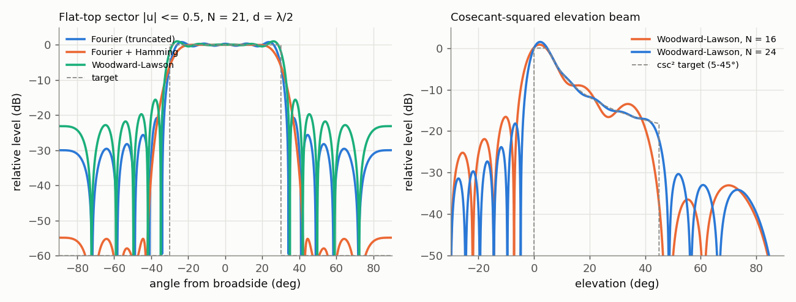
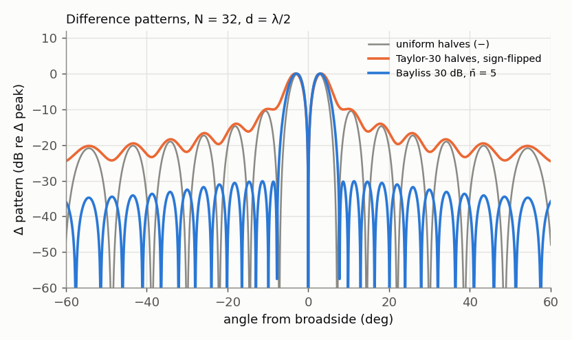
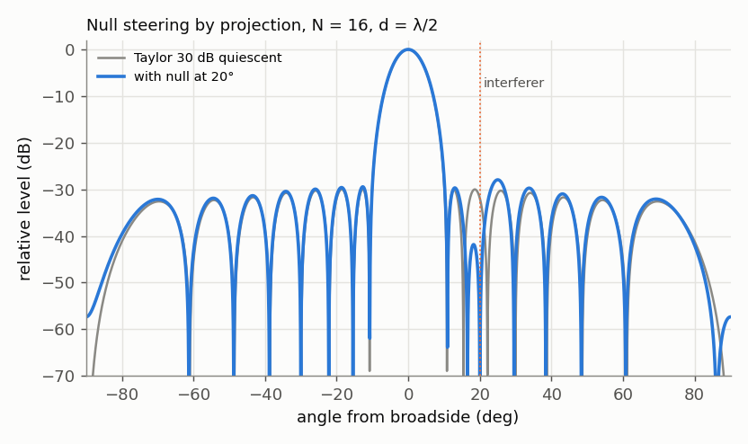

# Array pattern synthesis

## Questions this page answers
- How do I design array weights that give a pattern I choose, rather than just a narrow beam?
- What is the Schelkunoff polynomial method, and how do I put nulls exactly where I want them?
- How do I make a two-element cardioid (endfire) array, and what feed phase does it need at 433 MHz?
- How do I get a flat-topped sector beam or a cosecant-squared beam from an array?
- What is Woodward–Lawson synthesis and how is it different from Fourier synthesis?
- Why does my "ideal" flat-top pattern always ripple by about 1–2 dB at the edges (Gibbs)?
- How do I use least squares or linear programming (convex optimisation) to synthesise a pattern with nulls?
- Is Dolph–Chebyshev really optimal, and how can I check that with an optimiser?
- What is a Bayliss taper and why can't I just flip the sign of half a Taylor taper for monopulse?
- How do I steer a null onto an interferer without wrecking my main beam, and how deep will the null really be?
- How does deterministic null steering relate to adaptive (MVDR) nulling?

## TL;DR
- **Synthesis = the inverse problem**: given a desired pattern (beam shape, sidelobe envelope, nulls), find the weights. For a uniformly spaced linear array the AF is a **polynomial in z = e^{jkdu}** (Schelkunoff) and a **Fourier series in u** — every method below is a way of choosing its N−1 zeros or N coefficients.
- **Schelkunoff zero placement**: AF = a_{N−1}Π(z − z_i). Zeros on the unit circle are exact nulls; the visible part of the circle is the arc |ψ| ≤ kd (full circle at d = λ/2). A zero at radius 0.95 instead of 1 leaves only a −29 dB dip (8 elements). Placing *all* zeros arbitrarily gives no control of the beam: 4 elements with nulls at −40°/+25°/+55° move the beam peak to −7.2° (verified).
- **Two-element cardioid**: d = λ/4 with one zero at backfire → the far element lags 90°; D = 2 (3.01 dBi for isotropic elements), a perfect null behind. At 433.92 MHz: 173 mm spacing, 114 mm of extra VF-0.66 coax.
- **Fourier synthesis = least squares** over the visible region when d = λ/2 (verified to 1e−4). Truncation gives **Gibbs ripple ≈ 1.2–1.3 dB p-p that does not shrink with N** (21 or 41 elements); windowing trades ripple and sidelobes for a wider edge.
- **Woodward–Lawson**: superpose N orthogonal uniform beams pointed at u_m = mλ/(Nd), each weighted by the desired pattern there — the pattern passes *exactly* through the samples. Half-amplitude samples at the sector edge drop the sidelobes from −19.6 to −37.8 dB (N = 20). A **cosecant-squared** beam (5–45°) needs N ≥ 17 at λ/2 to stay within ±1.5 dB; 24 elements give ±0.46 dB.
- **Min-max (Chebyshev) synthesis is a linear program** for real symmetric weights: our LP reproduces Dolph–Chebyshev exactly (−30.00 dB, weight correlation 1.000000) and then adds a −60 dB null sector at 35–45° for 3.2 dB of sidelobe level and 0.16 dB of extra taper loss.
- **Bayliss (1968)** is the Taylor-like taper for **difference (Δ) patterns**: −30 dB, n̄ = 5 sampled on 16/32/64 elements gives −29.3/−30.1/−30.3 dB sidelobes with 91% of the uniform-Δ slope. A sign-flipped Taylor gives −9.6 dB sidelobes *and* only 71% of the slope. With the same slope and main-lobe width, the LP min-max optimum is only 0.3 dB better than Bayliss.
- **Null steering by projection** (Steyskal) = quiescent pattern minus a scaled beam pointed at the interferer: a null on a −32 dB sidelobe at 20° costs 0.02 dB of gain (16 elements); a null 3° from boresight costs 4.3 dB. Real null depth is set by errors: 0.3 dB/2° rms → median −39 dB, 90th percentile −34 dB. MVDR with a strong interferer converges to exactly this projection.

## Intuition (no math)

**An array pattern is built from a limited set of "Lego bricks".** An N-element array has N complex weights, so it can only make N independent things happen. You can spend them on beam shape, on low sidelobes, or on nulls in chosen directions — but not on everything at once. Every synthesis method is a strategy for spending those N degrees of freedom.

**Zeros are the most direct handle.** The pattern of an equally spaced array behaves like a polynomial, and a polynomial is completely described by its roots. Each root is a direction in which the element contributions cancel exactly. Choose where the roots go and you have chosen the pattern (up to a scale). Schelkunoff's insight was to draw these roots on a circle: walking around the circle is walking across the sky.

**Fourier and Woodward–Lawson come at it from the other end.** Because the pattern is the Fourier transform of the aperture weights, you can ask "which weights transform into the shape I want?" Fourier synthesis computes the weights directly, then has to cut them off at N elements — and cutting off a series always leaves an overshoot ripple near sharp edges (the Gibbs phenomenon you see in filter design). Woodward–Lawson instead builds the shape out of N narrow beams side by side, each turned up or down to match the target at its peak. Because each beam is zero at the peaks of all the others, the result hits the target exactly at those N points and interpolates smoothly between them.

**Optimisers do the bookkeeping for you.** If you can write "make the sidelobes below t everywhere, keep the beam at 1 here, make a null there" as a set of linear inequalities, a linear-programming solver finds the best weights in milliseconds. It is the modern way to do synthesis, and a good way to check whether a classical taper is near-optimal.

**Difference patterns need their own taper.** A tracking (monopulse) antenna compares the two halves of the aperture: the difference pattern has a null on boresight and two lobes either side. Making its sidelobes low is a different problem from making the sum beam's sidelobes low. Flipping the sign of half a Taylor taper puts a big step in the middle of the aperture, and steps make sidelobes. Bayliss built the difference-pattern equivalent of Taylor's method.

**A null is a second beam that cancels the first.** To cancel an interferer arriving in a sidelobe, form a second beam aimed at the interferer, scale it to exactly the sidelobe level there, and subtract it. The main beam barely notices if the interferer is far from it (the cancelling beam is weak at boresight). If the interferer is close to the main beam, the cancelling beam takes a big bite out of it.

## The math

Conventions as in the [array factor page](array-factor-linear-arrays.md): θ from broadside, u = sinθ, ψ = kd·u (rad), elements at x_n, AF(u) = Σ w_n e^{jkx_n u}, time convention e^{+jωt}. For the polynomial view x_n = nd (n = 0 … N−1); otherwise the array is centred.

### Level 1 — the synthesis problem and the toolbox

Given a desired field pattern D(u) (complex or magnitude-only) and sometimes constraints (nulls, sidelobe mask, main-beam value), find w ∈ ℂᴺ.

| Method | What you specify | What you get | Typical use |
|---|---|---|---|
| Schelkunoff zero placement | the N−1 zeros (directions) | exact nulls; beam shape uncontrolled | endfire/cardioid pairs, fixed nulls, teaching |
| Fourier series | D(u) on the visible region | least-squares best fit; Gibbs ripple | sector beams, quick shaped beams |
| Woodward–Lawson | D(u_m) at N sample points u_m = mλ/(Nd) | exact match at samples; smooth between | shaped beams (sector, csc²), beam-forming matrices |
| Least squares (+ constraints) | D(u), weight function, null directions | best fit with exact nulls | shaped beams with nulls |
| Min-max (LP/convex) | sidelobe mask, main-beam constraint, nulls | optimal peak sidelobe for the mask | any constrained design; checking optimality |
| Dolph–Chebyshev / Taylor | sidelobe level (and n̄) | low-sidelobe sum beam | see [tapering](tapering-sidelobe-control.md) |
| Bayliss | Δ sidelobe level and n̄ | low-sidelobe difference beam | monopulse tracking |
| Null steering (projection) | quiescent weights + interferer directions | minimum change of quiescent weights | fixed known interferers |

The number of independent conditions you can impose is at most **N** (complex) — e.g. N−1 nulls plus a beam normalisation.

### Level 1½ — synthesis by hand with two and three elements
- **The pattern is a polynomial.** With elements spaced $d$ and $u = \sin\theta$, element $n$ contributes $w_n z^n$ with $z = e^{jkdu}$. Two elements give $AF = w_0 + w_1z$, and three give $w_0 + w_1z + w_2z^2$. The question "which directions are nulls?" becomes "where is the polynomial zero?".
- **One null, two elements.** $w_0 + w_1z = 0$ when $z = -w_0/w_1$. Choose the null direction $u_0$, compute $z_0 = e^{jkdu_0}$, and set $w_1 = -w_0/z_0$.
- **Two nulls, three elements.** Multiply the factors: $AF = (z - z_1)(z - z_2) = z^2 - (z_1+z_2)z + z_1z_2$. The weights are the coefficients, so $w_2 = 1$, $w_1 = -(z_1+z_2)$ and $w_0 = z_1z_2$. This is Schelkunoff's method. N elements allow N − 1 nulls.
- **Woodward–Lawson as sampling.** Instead of zeros, specify the pattern value at N equally spaced directions $u_m = m\lambda/(Nd)$. Each sample is one uniform beam pointed at $u_m$, scaled to the wanted value. Between samples the pattern is smooth.

*Worked numbers (verified, `tools/verify/s18_level15_numbers.py`).* Two elements λ/4 apart (kd = π/2). For a null straight back (u = −1), $z_0 = e^{-j\pi/2} = -j$, so $w_1 = -1/(-j) = -j$: feed the second element 90° late.
- **Back:** the pattern is $|1 + (-j)(-j)| = 0$, an exact null.
- **Front** (u = +1): $|1 + (-j)(j)|$ = 2, the full two-element gain.
- **Broadside:** $|1 - j| = \sqrt2$ (−3 dB).

This is the classic cardioid. For Woodward–Lawson with 8 elements at λ/2, the sample directions are 0.25 apart in sinθ.

### Level 2 — derivations

**(a) Schelkunoff's polynomial and the unit circle [1].** With x_n = nd and z = e^{jψ}, ψ = kd(u − u₀) for a steered array (or ψ = kdu with the steering absorbed into the weights):
$$AF(z) = \sum_{n=0}^{N-1} a_n z^n = a_{N-1}\prod_{i=1}^{N-1}(z - z_i).$$
The fundamental theorem of algebra says the N−1 roots z_i determine AF up to a constant. |AF| is the product of the **distances from the point z = e^{jψ} on the unit circle to each root**. As θ sweeps from −90° to +90°, u goes from −1 to +1, and z moves along the unit circle through an angle 2kd. Consequences:
- A root on the unit circle at ψ_i = kd·u_i is an exact null in direction u_i (verified: < −250 dB in `e8_synthesis.py` §1).
- For d = λ/2 the visible arc is exactly one full turn; for d < λ/2 part of the circle is invisible (d = 0.3λ: |ψ| ≤ 108°, so only zeros inside that arc produce visible nulls); for d > λ/2 the arc wraps past itself and the main beam is revisited (grating lobe).
- Zeros of a uniform array sit at ψ = 2πm/N, m = 1 … N−1 (the N-th roots of unity except 1); the polynomial is (zᴺ − 1)/(z − 1) = 1 + z + … + z^{N−1} (verified).
- A root at radius r ≠ 1 gives a finite minimum of depth ≈ |1 − r| × (distance to the other roots)/(…) — numerically, 8-element uniform array with one zero moved to r = 0.99 / 0.95: the "null" is only −43 / −29 dB. **Real hardware moves your zeros off the circle**: amplitude and phase errors are equivalent to small random root displacements.

*Worked derivation — the cardioid.* Two elements, d = λ/4. Put the single zero at backfire, u = −1: ψ₁ = kd(−1) = −π/2, z₁ = e^{−jπ/2} = −j. Then AF = z − z₁ = z + j, i.e. a₀ = j, a₁ = 1: the element at x = d is fed **90° later** than the one at the origin (a₁/a₀ = −j). |AF|² = |e^{jπu/2} + j|² = 2 + 2 sin(πu/2), which is 4 at u = +1 (endfire forward) and 0 at u = −1. For isotropic elements on a line, the directivity is the peak over the angle-average of |AF|²; with the array axis as the polar axis the average is ½∫_{−1}^{1}|AF|²du = 2, so **D = 4/2 = 2 (3.01 dBi)**. This agrees with the closed-form uniform-array directivity of the [array factor page](array-factor-linear-arrays.md) §(f): D = 4/[2 + 2 sinc(kd) cos(kd)] = 2 (both verified).

*A cautionary example.* N = 4, d = λ/2, zeros at θ = −40°, +25°, +55° (all three available roots used). The weights come out as |a| = 0.833, 1, 1, 0.833 with phases −30.4°, 0°, 11.4°, 41.8°. The nulls are exact, but nothing constrained the beam: it peaks at **−7.2°**, the broadside level is −0.79 dB below the peak, and the taper efficiency is 0.821 (−0.85 dB). With N−1 zeros fully committed there is no freedom left. Practical designs fix only some zeros (and leave the rest to a taper or an optimiser) — that is null steering, (g) below.

**(b) Fourier-series synthesis [2], [3].** For a centred array with d = λ/2, AF(u) = Σ w_n e^{jπnu} is a Fourier series in u with period 2, which is exactly the visible region. Given D(u) on [−1, 1], the coefficients that minimise ∫_{−1}^{1}|AF − D|²du are the Fourier coefficients
$$w_n = \tfrac12\int_{-1}^{1} D(u)\,e^{-j\pi n u}\,du .$$
(Orthogonality of e^{jπnu} on [−1, 1] makes Fourier = least squares; verified to 1e−4, §4a.) For a flat-top sector D = 1 for |u| ≤ u_c: **w_n = sin(nπu_c)/(nπ)** (w₀ = u_c), the sinc weights of an ideal low-pass FIR filter. For d ≠ λ/2 the period in u is λ/d, so the series must be defined over a period that is larger (d < λ/2, the invisible region is "free") or smaller (d > λ/2, D must be periodic: grating lobes) than the visible region.

*Gibbs.* Truncating to N terms convolves D with a Dirichlet kernel, so a step always overshoots by ≈ 9% of the jump, independent of N: the ripple stays ≈ **1.2–1.3 dB p-p** (N = 21: 1.32 dB; N = 41: 1.19 dB) while the edge sharpens as 1/N (10–90% width 0.090 → 0.045 in u). A window (Hamming) removes the overshoot and the far sidelobes (−55 to −57 dB beyond |u| = 0.7) but doubles the edge width (0.176 at N = 21); the ripple inside the flat region then becomes a slow droop (2.5 dB at N = 21, 0.7 dB at N = 41) unless N is generous. This is exactly the FIR windowing trade ([digital filters](../14-sdr-dsp/digital-filters-fir-iir.md)).

**(c) Woodward–Lawson sampled-beam synthesis [4], [5].** A uniform array steered to u_m has pattern
$$B_m(u) = \frac{\sin\!\big(N\pi d(u-u_m)/\lambda\big)}{N\sin\!\big(\pi d(u-u_m)/\lambda\big)},$$
which equals 1 at u_m and **0 at every u_m + pλ/(Nd)** (its nulls). So beams spaced Δu = λ/(Nd) are orthogonal in the sense that each is zero at the other peaks. Superpose them with amplitudes equal to the desired pattern:
$$AF(u) = \sum_m D(u_m)\,B_m(u)\quad\Rightarrow\quad w_n = \frac1N\sum_m D(u_m)\,e^{-jkx_n u_m},\qquad u_m = m\frac{\lambda}{Nd},\ |u_m|\le 1 .$$
AF(u_m) = D(u_m) exactly (verified to 6e−16). Between samples the pattern is a sinc interpolation, so it ripples where D changes fast. For d = λ/2 there are N + 1 candidate samples in [−1, 1], but u = ±1 are the same beam (ψ differs by 2π) — use only one of them. Design rules:
- The edge of a sector falls between samples unless N is chosen so that a sample lands on it. N = 20 (samples every 0.1 in u) puts samples at u = ±0.5: with hard 1/0 samples the sidelobes are −19.6 dB; setting the two edge samples to **0.5** (the average of the two sides) gives −37.8 dB at the cost of 0.6 dB more ripple — a cheap "built-in taper".
- WL is not least squares: for the same N it has slightly more ripple (1.45 dB vs 1.32 dB, N = 21 sector) and much higher far sidelobes than the windowed Fourier design, but its weights are trivially computed and **it maps directly onto hardware**: a Butler matrix produces exactly these orthogonal beams ([architectures](beamforming-architectures.md)), so a set of fixed attenuators on the Butler beam ports synthesises the WL pattern.

*Cosecant-squared beams — why csc².* A target or user at constant height h seen at elevation angle ε is at range R = h/sin ε. One-way received power ∝ G(ε)/R² ∝ G(ε) sin²ε, radar echo power ∝ G²/R⁴ ∝ G² sin⁴ε. **Both are constant if G(ε) ∝ csc²ε**, i.e. field ∝ csc ε. A csc² beam from ε₁ to ε₂ gives a constant signal for anything flying at constant altitude — the classic air-surveillance and airport-radar elevation pattern, and a sensible fixed ground antenna for a drone or aircraft at fixed altitude. (A rocket does not fly at constant altitude, so for rocket telemetry csc² is not the right target; a broad tilted beam or tracking is — see [stacking](stacking-and-arraying-yagis.md) and [DIY projects](diy-phased-array-projects.md).)

WL csc² design (vertical array, d = λ/2, field = 1 for 0 ≤ ε < 5°, sin5°/sin ε for 5–45°, 0 elsewhere), `e8_synthesis.py` §3 and figure below:

| N | Deviation from csc², 7–38° | Deviation 6.5–42° | Highest lobe below −5° | Highest lobe above 53° |
|---|---|---|---|---|
| 16 | −2.5/+2.7 dB | ±6.6 dB (the last non-zero sample is at 38.7°, so the pattern rolls off early) | −10.8 dB | −33.1 dB |
| 17 | — | **≤ ±1.5 dB (smallest N that meets it)** | — | — |
| 24 | −0.46/+0.38 dB | ±0.46 dB | −18.2 dB | −31.1 dB |

The ground-side lobes (below the horizon) are the weak point of a short csc² array: they are where the ground reflection and clutter come from. Weighting the LS fit more heavily below the horizon, or an LP mask, fixes it.

**(d) Least squares with constraints.** Sample the visible region (or weight it with W(u)): minimise ‖Aw − D‖² where A_{in} = e^{jkx_n u_i}. The normal equations Rw = b with R = AᴴA, b = AᴴD give the unconstrained optimum w₀ (= Fourier for d = λ/2). Adding exact nulls Cw = 0 (each row c = [e^{jkx_n u_k}]) via Lagrange multipliers:
$$\mathbf w = \mathbf w_0 - \mathbf R^{-1}\mathbf C^H\big(\mathbf C\mathbf R^{-1}\mathbf C^H\big)^{-1}\mathbf C\mathbf w_0 .$$
Example (§4): the 21-element sector with a null forced at 40° (outside the sector): null −313 dB (numerical zero), ripple 1.32 → 1.36 dB, sidelobes beyond |u| = 0.7 −25.7 → −23.7 dB. Derivative constraints (dAF/du = 0 at u_k) widen a null; magnitude-only targets need iteration (alternating projection: fit, replace the phase of D with the phase of the current AF, refit).

**(e) Min-max (Chebyshev) synthesis as a linear program [6], [7].** For real symmetric weights b_k (centred array), AF(u) = Σ_k b_k·2cos(kx_k u) is *real* and linear in b. "Minimise the peak sidelobe" is then
$$\min_{\mathbf b,\,t}\ t\quad\text{s.t.}\quad -t\le AF(u_i)\le t\ (u_i\ \text{in sidelobe region}),\quad AF(0)=1,\quad AF(u)\le 1\ (\text{main lobe}),\quad |AF(u_k)|\le \epsilon\ (\text{nulls}),$$
a linear program (scipy `linprog`/HiGHS, milliseconds). For complex weights |AF| ≤ t is a second-order cone; approximating the circle by a P-gon (Re(AF e^{−j2πp/P}) ≤ t) keeps it an LP with error 1/cos(π/P) (0.17 dB for P = 16), or use cvxpy for the exact SOCP (Lebret & Boyd [7]).
*Check of Dolph optimality.* The trap: Dolph–Chebyshev guarantees |AF| ≤ 1/R only beyond the point u_c where its main lobe has fallen to the sidelobe level, not beyond its first null. With the sidelobe region starting at u_c = 0.17379 (N = 16, 30 dB; first null at 0.18585) the LP returns **−30.00 dB and weights with correlation 1.000000 to `chebwin`** — Dolph is the min-max optimum. (Our first run used the first null as the edge; the looser problem let the LP reach −32.6 dB. Logged in research-logs/W5-E8.) Adding a −60 dB null sector at 35–45° (both sides): remaining peak sidelobe −26.8 dB, taper efficiency −0.81 dB (Dolph −0.65 dB) — every constraint has a price, and the LP tells you exactly what it is.

**(f) Bayliss difference patterns [8].** A difference pattern Δ(u) must be odd, zero on boresight, with maximum slope there for a given sidelobe level. Bayliss's construction (line source of length L, u = (L/λ)sinθ):
1. Start from Taylor's ideal sum pattern cos(π√(u² − A²)), whose sidelobes are all equal ([tapering](tapering-sidelobe-control.md) §(d)). Its **derivative** is an odd function with a zero at the origin: a model difference pattern. Its zeros are at u = 0 and ±√(A² + n²).
2. The derivative's first few sidelobes are not equal; Bayliss moved the first four zeros to new positions ξ₁ … ξ₄, found iteratively so that the sidelobes are equal, and fitted A, ξ₁…ξ₄ and the peak position p₀ by 4th-degree polynomials in the sidelobe level S (dB, negative):

| Parameter | C₀ | C₁ | C₂ | C₃ | C₄ |
|---|---|---|---|---|---|
| A | 0.30387530 | −0.05042922 | −0.00027989 | −0.00000343 | −0.00000002 |
| ξ₁ | 0.98583020 | −0.03338850 | 0.00014064 | 0.00000190 | 0.00000001 |
| ξ₂ | 2.00337487 | −0.01141548 | 0.00041590 | 0.00000373 | 0.00000001 |
| ξ₃ | 3.00636321 | −0.00683394 | 0.00029281 | 0.00000161 | 0.00000000 |
| ξ₄ | 4.00518423 | −0.00501795 | 0.00021735 | 0.00000088 | 0.00000000 |
| p₀ | 0.47972120 | −0.01456692 | −0.00018739 | −0.00000218 | −0.00000001 |

(value = Σ C_i S^i; re-typed from Bayliss 1968, Fig. 4 [8]. E.g. S = −30 dB → A = 1.6413.)
3. For realisability, keep the model zeros Z_n (ξ_n for n ≤ 4, √(A² + n²) for n ≥ 5) only for n < n̄, dilated by **σ = (n̄ + ½)/Z_n̄**, and use the zeros n + ½ of a uniform-difference aperture beyond:
$$F(u) = u\cos(\pi u)\,\frac{\prod_{n=1}^{\bar n-1}\big[1-(u/\sigma Z_n)^2\big]}{\prod_{m=0}^{\bar n-1}\big[1-(u/(m+\tfrac12))^2\big]} .$$
4. The aperture distribution is a finite sine series. A term sin((m + ½)πp) on p = 2x/L ∈ [−1, 1] has the transform (2j/π)(−1)^m u cos(πu)/((m + ½)² − u²), which is j at u = m + ½ and zero at every other half-integer, so
$$g(p) = \sum_{m=0}^{\bar n-1} B_m \sin\!\big((m+\tfrac12)\pi p\big),\qquad B_m = F(m+\tfrac12)$$
(the removable 0/0 at u = m + ½ is evaluated analytically). This is Woodward–Lawson in disguise: the coefficients are the pattern's samples at the uniform-difference beam peaks. Sampling g at the element positions gives array weights, as for Taylor.

Our implementation (§6) checks: the sine series reproduces the zero-product F(u) to 1e−13; the computed peak position equals 0.991 × σp₀ for every S from −20 to −40 dB (a check on the table transcription). Results:

| Design (continuous) | n̄ = 5: max sidelobe | n̄ = 6 | Peak position u |
|---|---|---|---|
| −20 dB | −20.37 | −20.29 | 0.754 |
| −25 dB | −25.34 | −25.30 | 0.793 |
| −30 dB | −30.32 | −30.32 | 0.828 |
| −35 dB | −35.04 | −35.21 | 0.859 |
| −40 dB | **−38.30** | −39.74 | 0.887 |

At −40 dB, n̄ = 5 misses by 1.7 dB (the transition sidelobe at n̄ rises; Bayliss himself warns that the polynomial fits degrade low-sidelobe designs and recommends the iterated zeros there) — use n̄ ≥ 6 below −35 dB.

Sampled arrays (d = λ/2, −30 dB, n̄ = 5): N = 16 → −29.33 dB, N = 32 → −30.14 dB, N = 64 → −30.31 dB. Boresight slope relative to the uniform-difference slope at equal excitation power: 0.972 (−25 dB), **0.913** (−30 dB), 0.864 (−35 dB). The sign-flipped Taylor-30 Δ (N = 16/32) gives −9.6/−9.9 dB sidelobes and 0.708 of the slope; the uniform Δ gives −10.1/−10.5 dB and full slope. The LP min-max Δ with the same slope and the same main-lobe region (|Δ| below the Bayliss sidelobe level beyond u = 0.2576, N = 16) reaches −29.62 dB: **the sampled Bayliss is within 0.3 dB of optimal** while keeping Taylor-like decaying far sidelobes.

**(g) Null steering against an interferer [9], [10].** Keep a good quiescent design w_q (e.g. Taylor) and impose nulls Cw = 0 while changing the weights as little as possible: min ‖w − w_q‖² s.t. Cw = 0 gives the projection
$$\mathbf w = \big[\mathbf I - \mathbf C^H(\mathbf C\mathbf C^H)^{-1}\mathbf C\big]\mathbf w_q .$$
For one null at u_I, C = cᵀ with c_n = e^{jkx_n u_I}, and the pattern becomes
$$AF(u) = AF_q(u) - AF_q(u_I)\,\underbrace{\frac1N\sum_n e^{jkx_n(u-u_I)}}_{\text{uniform beam steered to }u_I}$$
(verified to 1e−10, §7b): **the quiescent pattern minus a cancellation beam** pointed at the interferer and scaled to the quiescent level there (Applebaum's and Steyskal's picture). Consequences, all from §7 (N = 16, Taylor 30 dB, λ/2):
- Interferer on a sidelobe (20°, quiescent −32 dB): main beam −0.02 dB, peak sidelobe −30.0 → −27.9 dB (the cancellation beam's own sidelobes add to the pattern).
- Interferer near the main beam (HPBW 8.0°): at 6° the cost is ≈0 (it is near a quiescent null), at 4° −2.0 dB, at **3° −4.3 dB** of SNR gain. You cannot null inside the main beam without destroying it.
- Uncertain direction: a single null is only −45 dB just 0.01 in u away; adding a **derivative null** (dAF/du = 0) gives −64 dB there at the cost of one more degree of freedom.
- **Errors limit the depth**: the null is an exact cancellation of two large numbers, so the random-error floor of the [tapering page](tapering-sidelobe-control.md), (σ_a² + σ_φ²)/(Nη_t), applies at the null. 0.3 dB / 2° rms → floor −37.5 dB; Monte Carlo median −39.2 dB (an exponentially distributed power has its median 1.6 dB below its mean), 90th percentile −34.0 dB. Quantising the null-steered weights to 6-bit phase and 0.5 dB amplitude steps alone gives −38.7 dB.
- **Adaptive nulling is the same thing, learned from data.** MVDR with white noise plus one interferer of INR ≥ 20 dB returns weights that are a scaled copy of the projected uniform beam (correlation 1.000000); the null depth relative to the beam is |AF_q(u_I)|/(1 + N·INR) in amplitude, so it deepens by 2 dB per dB of INR (−85 dB at 20 dB INR, N = 16). See [adaptive beamforming](adaptive-beamforming-doa.md).

### Level 3 — beyond linear arrays and linear constraints

- **Magnitude-only (power-pattern) targets**: the phase of D is free. Either iterate (alternating projections between "patterns meeting the mask" and "patterns an N-element array can make" — the intersection approach of Bucci and co-workers), or use spectral factorisation: |AF|² is a real trigonometric polynomial in u, so a power-pattern LP followed by spectral factorisation gives the global min-max optimum for linear arrays (Wu, Boyd & Vandenberghe's FIR approach applies directly).
- **Phase-only synthesis**: transmit arrays with saturated PAs can only change phase. Nulling by phase-only perturbation is non-linear but works for small perturbations (pairs of nulls at ±u for real-symmetric cases); expect shallower nulls and higher sidelobes than with amplitude control.
- **Elliott's method** (iterative perturbation of the Taylor/Bayliss zeros) gives sidelobes of individually arbitrary heights, e.g. low sidelobes only toward the ground [11].
- **Planar and circular apertures**: separable synthesis (x-pattern × y-pattern) is easy; rotationally symmetric low sidelobes need circular Taylor (Taylor 1960) and circular Bayliss — Bayliss's 1968 paper is mostly about the *circular* aperture (Fourier–Bessel series); the line source is its appendix. Not implemented here.
- **Embedded element patterns and coupling**: everything above assumes pattern multiplication. With strong coupling, synthesise against the measured or simulated embedded element patterns (replace e^{jkx_n u} by f_n(u)e^{jkx_n u} in A) — same LS/LP formulation ([planar arrays & coupling](planar-arrays-element-pattern-coupling.md), [conformal arrays](conformal-and-cylindrical-arrays.md), where element patterns all differ).
- **Robustness**: add a white-noise-gain (‖w‖²) constraint to any optimisation; superdirective-looking LP solutions with huge alternating weights are a sign the mask is over-constrained.

## Design equations & rules of thumb

| Equation / rule | When valid | Typical values (verified) |
|---|---|---|
| AF = a_{N−1}Π(z − z_i), z = e^{jkdu} | equal spacing | visible arc 2kd (full circle at λ/2) |
| Cardioid pair: d = λ/4, far element lags 90° | endfire, null behind | D = 2 (3.0 dBi, isotropic); 173 mm @ 433.92 MHz |
| Zero off the circle (r = 0.95) → finite dip | errors, coupling | −29 dB (8 el) |
| Fourier sector: w_n = sin(nπu_c)/(nπ) | d = λ/2 (= least squares) | Gibbs ripple ≈ 1.2–1.3 dB p-p for any N |
| WL samples at u_m = mλ/(Nd), w = (1/N)Σ D(u_m)e^{−jkx_n u_m} | any d ≤ λ/2 | exact at samples |
| WL half-amplitude edge sample | sector beams | sidelobes −19.6 → −37.8 dB (N = 20) |
| csc² field from ε₁ to ε₂ | constant-altitude coverage | N ≥ 17 for ±1.5 dB (5–45°); N = 24 → ±0.46 dB |
| Min-max = LP (real symmetric) / SOCP (complex) | any linear mask | reproduces Dolph exactly |
| Bayliss: σ = (n̄ + ½)/Z_n̄, B_m = F(m + ½) | Δ patterns | −30 dB, n̄ = 5: N = 16 → −29.3 dB; slope 0.91 of uniform Δ |
| Bayliss n̄ ≥ 6 below −35 dB | polynomial-fit limits | −40 dB: n̄ = 5 → −38.3, n̄ = 6 → −39.7 dB |
| Null steering: AF = AF_q − AF_q(u_I)·B_I(u) | known interferer | sidelobe null costs ~0.02 dB; 3° from an 8° beam costs 4.3 dB |
| Null depth floor ≈ (σ_a² + σ_φ²)/(Nη_t); σ_a ≈ 0.115 σ_dB | random errors | 0.3 dB / 2°, N = 16: median −39 dB |
| Derivative null widens the null | direction uncertainty | −64 vs −45 dB at Δu = 0.01 |

## Worked examples

**Example 1 — A 433 MHz two-element cardioid for a recovery-beacon receiver.** f = 433.92 MHz → λ = 299.79/433.92 = 0.6909 m. Spacing d = λ/4 = 172.7 mm. Two vertical λ/2 dipoles (or ground-plane whips); the element *toward* which you want the beam is fed 90° later. A 90° delay is an extra λ/4 of cable: 0.66 × 172.7 = **114 mm of RG-58 (VF 0.66)** or 0.695 × 172.7 = 120 mm of RG-316, fed from a 2-way splitter. In azimuth (for isotropic-in-azimuth vertical dipoles) the pattern is |AF|² ∝ 1 + sin((π/2) cos φ) — a cardioid with a theoretical null directly behind. Directivity of the array factor alone is 2 (3 dB) on top of the element's elevation directivity. Mutual coupling between λ/4-spaced dipoles changes the element currents (driven currents are no longer equal and 90° apart for equal voltages), so the real null is shallower and slightly displaced — tune by NEC (`tools/verify/ant_mom_general.py` or PyNEC) or by measuring; a current-forcing feed (λ/4 lines from a common point, the "Christman/Lewallen" methods used for amateur phased verticals) restores the current ratio. Use: a switchable front/back null for direction-finding a landed rocket's beacon — rotate until the signal *vanishes*; a null is sharper than a peak.

**Example 2 — Nulling a known interferer with a 16-element 5.8 GHz receive array.** Quiescent Taylor 30 dB (n̄ = 5), d = λ/2 = 25.8 mm, beam at broadside, interferer (e.g. a video downlink) at 20°. Quiescent level there −32 dB. Projection null: weights change by the cancellation beam, main beam −0.02 dB, highest sidelobe −27.9 dB. With ADAR1000-class hardware (0.5 dB amplitude steps, 6-bit phase) the null is ≈ −39 dB; with additional 0.3 dB / 2° rms calibration errors the median is −39 dB and 1 build in 10 is worse than −34 dB. Interference rejection relative to the main beam therefore improves from 32 dB to ≈ 34–39 dB — a modest gain because the Taylor sidelobe was already low. The big win is when the interferer sits on a −13 dB uniform-array sidelobe: then nulling buys ≈ 25 dB. If the interferer's direction is only known to ±0.6° (Δu = 0.01), use a derivative null: −64 dB vs −45 dB at the edge of the uncertainty.

**Example 3 — A flat-topped ±30° sector beam for a fixed ground array.** Goal: constant gain over ±30° in azimuth (a fixed antenna covering a launch range without tracking), N = 20 at λ/2. WL with samples every 0.1 in u, D = 1 for |u| < 0.5, 0.5 at |u| = 0.5, 0 beyond: ripple 2.0 dB p-p, sidelobes −37.8 dB, edge 10–90% width 0.13 in u (≈ 9° at 30°). Gain: the beam now fills Δu ≈ 1 instead of ≈ 0.09 (the uniform HPBW in u), so the array-factor directivity drops from 20 (13.0 dBi) to **2.1 (3.2 dBi) at the sector centre, 1.5 dBi near its edge** (computed for isotropic elements, D(u) = |AF(u)|²/Σ|w|² at λ/2) — shaped beams spend almost all of the array gain on coverage. At 433 MHz the same array is 6.9 m long: a sector beam at UHF is a job for a single wide-beam antenna, not an array.

**Example 4 — Bayliss Δ weights for a 16-element monopulse array (−30 dB, n̄ = 5).** Element positions x_n = (n − 7.5)·λ/2. Weights (antisymmetric; listed from the centre outward, max = 1): **0.225, 0.628, 0.901, 1.000, 0.931, 0.737, 0.496, 0.324** (the left half is the negative mirror image). The Δ peak is at u = 0.104 (6.0°), the sidelobes −29.3 dB, and the boresight slope 91% of the uniform-difference value. Use a Taylor 30 dB Σ taper on the same elements (separate weight sets in a digital array, or a monopulse comparator network in an analog one). Angle estimation from Δ/Σ is on the [radar tracking & monopulse page](../11-radar/radar-tracking-monopulse-and-trackers.md).

**Example 5 — Checking a design with the LP.** You have a 16-element Dolph-30 design and want a −60 dB null band at 35–45° (to suppress a strong emitter whose bearing wanders). The LP (real symmetric weights, same main-lobe edge u_c = 0.174) says the best achievable peak sidelobe elsewhere is −26.8 dB and the taper loss rises from 0.65 to 0.81 dB. If −26.8 dB is unacceptable, you need more elements, a narrower null band, or to accept a wider main beam — the LP makes the trade explicit.

## Practical notes
- **Degrees of freedom are hardware**: every null or shaped feature needs an independently controllable weight. A passive corporate feed with fixed splits can implement one synthesised pattern; electronic nulling needs per-element amplitude *and* phase control (or digital beamforming).
- **Quantisation and calibration cap null depth at ≈ (σ_a² + σ_φ²)/(Nη)**; a "−300 dB" null in simulation is −35 to −45 dB in a DIY array. Budget nulls like sidelobes ([array calibration](array-calibration.md)).
- **Measure in the far field** (> 2L²/λ); shaped beams and nulls are the first things the near field destroys.
- **Embedded element patterns**: synthesise against the measured/simulated element patterns when the elements are not identical (edges, conformal arrays, Yagi stacks).
- **Woodward–Lawson ↔ Butler**: a Butler matrix's beam ports are the WL beams; fixed attenuators/phase on those ports synthesise shaped beams without per-element control.
- **Wide-band**: synthesised patterns scale with frequency (u_m = mλ/(Nd)); a shaped beam designed with phase weights distorts off centre frequency — check the band edges.
- **Software**: `scipy.signal.windows.chebwin`/`taylor` for sum tapers; Bayliss is not in scipy — use `tools/verify/e8_synthesis.py` (`bayliss_weights(N, S, nbar)`); `scipy.optimize.linprog` (HiGHS) for min-max; cvxpy if available for SOCP.

## Common mistakes & misconceptions
- **"Put nulls wherever you like."** Each null uses one degree of freedom; using all N−1 leaves the beam wherever the algebra puts it (−7.2° in the 4-element example).
- **"A Schelkunoff null is infinitely deep."** Only if the root is exactly on the unit circle; r = 0.95 gives −29 dB, and real errors move the roots.
- **"More elements remove the Fourier ripple."** Gibbs overshoot (≈ 9% of the step, ≈ 1.2–1.3 dB p-p) is independent of N; only a window or a smoother target removes it.
- **"Woodward–Lawson is least squares."** It interpolates N samples; the Fourier/LS solution minimises the integrated error. They differ, and WL's far sidelobes are higher.
- **Double-counting the u = ±1 Woodward–Lawson beam** at d = λ/2 (it is one beam, not two).
- **"Dolph is optimal for a given first null."** It is optimal for a given main-lobe region measured to the point where the main lobe reaches the sidelobe level; using the first null as the edge lets an optimiser apparently "beat" Dolph (we made this mistake in the first run of our own check).
- **Making a Δ pattern by flipping the sign of half a Taylor taper.** Sidelobes −10 dB and 29% less slope (N = 16/32); use Bayliss (or an LP).
- **Expecting Bayliss −40 dB with n̄ = 5** — it gives −38.3 dB; use n̄ ≥ 6 or the iterated zeros.
- **Nulling an interferer inside the main beam** — the cancellation beam takes the main beam with it (−4.3 dB at 3° off a 8° beam). Use polarisation, frequency or time separation instead.
- **Forgetting that the cancellation beam has sidelobes** — nulling one interferer raises other sidelobes (−30 → −27.9 dB).
- **Sign conventions**: with AF = Σ w_n e^{+jkx_n u} the null constraint is cᵀw = 0 with c_n = e^{+jkx_n u_I} (no conjugate); with a beamformer output y = wᴴx it becomes wᴴa = 0. Mixing them puts the null on the mirror angle.

## How to simulate / verify
- `python3 tools/verify/e8_synthesis.py` (~7 s, **ALL PASS**): Schelkunoff identities, cardioid, null placement and off-circle zeros; Fourier sector and Gibbs; WL sector, half-amplitude edge, csc² vs N (minimum N search); LS = Fourier and constrained LS; LP min-max reproducing Dolph and adding a null sector; Bayliss continuous and sampled (polynomial table, p₀ check, comparison with sign-flipped Taylor and with the LP min-max Δ); projection null steering, derivative nulls, Monte-Carlo null depth, MVDR equivalence; writes the three figures and `tools/verify/e8_synthesis_output.txt`.
- Minimal recipe (numpy): `A = np.exp(1j*2*np.pi*np.outer(u, x/lam))`; LS: `w = np.linalg.lstsq(A, D)[0]`; null: `w -= np.linalg.pinv(C) @ (C @ w)` (projection for unit-norm rows); pattern `20*np.log10(abs(A@w))`.
- With mutual coupling: replace A by the NEC/openEMS embedded element patterns (one element driven, others terminated), e.g. from PyNEC runs ([antenna simulation](../08-antennas/antenna-simulation-nec-openems.md)).
- Hardware: an ADI Phaser or KrakenSDR can test projection nulls against a signal generator at a known bearing; expect depths of 25–40 dB set by calibration ([DIY projects](diy-phased-array-projects.md)).

## Open questions / gaps
- Circular-aperture Taylor and Bayliss (Fourier–Bessel) and Elliott's arbitrary-sidelobe perturbation method are described, not implemented.
- Power-pattern (magnitude-only) synthesis by spectral factorisation and phase-only nulling are described only qualitatively.
- The books Balanis ch. 7, Stutzman & Thiele ch. 3, Mailloux ch. 3, Hansen and Haupt were not re-read for this page; their synthesis examples were not compared one-to-one (methods were re-derived and verified numerically instead). Woodward (1946) and Woodward & Lawson (1948) were not read.
- No measured null depths on a real DIY array (KrakenSDR/Phaser) yet.

## Sources
1. S. A. Schelkunoff, "A mathematical theory of linear arrays," *Bell Syst. Tech. J.* 22(1):80–107, 1943 — polynomial representation, zeros on the unit circle, visible arc. (peer-reviewed; cited, not re-read)
2. C. A. Balanis, *Antenna Theory: Analysis and Design*, 4th ed., Wiley, 2016, ch. 7 "Antenna synthesis and continuous sources" (§7.3 Schelkunoff polynomial, §7.4 Fourier transform, §7.5 Woodward–Lawson) — method set and problem types. (textbook; cited, not re-read)
3. R. J. Mailloux, *Phased Array Antenna Handbook*, 2nd ed., Artech House, 2005, ch. 3 "Pattern synthesis for linear and planar arrays" — Fourier, Woodward, numerical synthesis, null steering. (textbook; cited)
4. P. M. Woodward, "A method of calculating the field over a plane aperture required to produce a given polar diagram," *J. IEE* 93(IIIA):1554–1558, 1946. (peer-reviewed; cited, not read)
5. P. M. Woodward, J. D. Lawson, "The theoretical precision with which an arbitrary radiation-pattern may be obtained from a source of finite size," *J. IEE* 95(37):363–370, 1948 — sampled-beam synthesis. (peer-reviewed; cited, not read)
6. H. L. Van Trees, *Optimum Array Processing*, Wiley, 2002, ch. 3 "Synthesis of linear arrays and apertures" — Fourier/LS synthesis, null steering, minimax design. (textbook; cited)
7. H. Lebret, S. Boyd, "Antenna array pattern synthesis via convex optimization," *IEEE Trans. Signal Process.* 45(3):526–532, 1997 — min-max and nulls as convex (SOCP/LP) problems. (peer-reviewed; cited, not read; formulation re-derived and verified against Dolph)
8. E. T. Bayliss, "Design of monopulse antenna difference patterns with low sidelobes," *Bell Syst. Tech. J.* 47(5):623–650, May–June 1968 — model difference function from the derivative of Taylor's ideal pattern, iterated first four zeros, polynomial fits of A, ξ₁…ξ₄, p₀ (Fig. 4), dilation σ, line-source sine series (appendix), circular-aperture Fourier–Bessel series. https://archive.org/details/bstj47-5-623 (peer-reviewed; READ via archive.org text)
9. H. Steyskal, "Synthesis of antenna patterns with prescribed nulls," *IEEE Trans. Antennas Propag.* 30(2):273–279, 1982 — minimum-change (projection) null synthesis, cancellation beams. (peer-reviewed; cited, not read; result re-derived and verified)
10. S. P. Applebaum, "Adaptive arrays," *IEEE Trans. Antennas Propag.* 24(5):585–598, 1976 — adaptive weights as quiescent minus cancellation beams. (peer-reviewed; cited)
11. R. S. Elliott, *Antenna Theory and Design*, rev. ed., Wiley-IEEE Press, 2003, ch. 5 — Taylor/Bayliss line sources, perturbation of zeros for arbitrary sidelobes. (textbook; cited, not re-read)
12. C. L. Dolph, *Proc. IRE* 34(6):335–348, 1946; T. T. Taylor, *IRE Trans. AP* 3(1):16–28, 1955 — sum-pattern tapers (see [tapering](tapering-sidelobe-control.md)). (peer-reviewed)
13. `tools/verify/e8_synthesis.py` and `e8_synthesis_output.txt` — every number on this page not otherwise attributed. (own verification)
