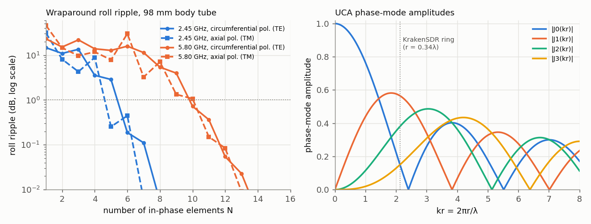

# Conformal and cylindrical arrays

## Questions this page answers
- What changes when array elements sit on a curved surface instead of a flat panel?
- Why doesn't "element pattern × array factor" work on a cylinder?
- How many antennas do I need around my rocket's body tube for a roll-omnidirectional (wraparound) pattern at 433 MHz, 915 MHz, 2.4 GHz or 5.8 GHz?
- Should a wraparound telemetry array be polarized along the rocket axis or around it?
- How does a cylindrical array scan 360° by switching (commutating) which elements are active?
- Why do conformal arrays have high cross-polarization, and what about a nose cone?
- What are "phase modes" of a circular array, and why does a KrakenSDR use a circle?
- Why does a simple phase-mode bearing estimate fail on a KrakenSDR-sized ring at 433 MHz while MUSIC works?
- How does a pseudo-Doppler direction finder work?
- How many elements does a GNSS (L1) wraparound need on a 4-inch or 6-inch airframe?
- What radius should a 5-element direction-finding ring have at 433, 868 or 915 MHz?

## TL;DR
- **On a curved surface every element points a different way**, so each element pattern is the same function rotated to its own position: E(φ) = Σ w_n g(φ − φ_n). There is no common element factor. For a 12-element sector beam on a 32-element ring (radius 2.55λ), "pattern multiplication" with the centre element's pattern errs by up to **1.7 dB** in the main-beam shape (verified with the exact cylinder solution).
- **Exact 2-D cylinder solutions** (infinite PEC cylinder, radius a): an axial slot radiates H_z ∝ Σ jⁿe^{jnφ}/H_n^{(2)′}(ka); an axial line current at standoff radiates E_z ∝ Σ jⁿ[J_n(kρ′) − J_n(ka)H_n(kρ′)/H_n(ka)]e^{jnφ}. Our TM series agrees with an independent 2-D MoM to **0.016 dB**. On a big cylinder a slot's field at grazing is **−3.2 dB** (independent of ka from 3 to 30). Behind the cylinder it decays (creeping waves): −10 dB at ka = 3, −25 dB at ka = 30.
- **Wraparound (roll-omni) arrays**: feed N elements in phase. The pattern is the m = 0 phase mode plus aliased modes m = ±N, ±2N…, which give a roll ripple 1 + 2ρe^{jχ}cos Nφ with ρe^{jχ} = j^N H′₀/H′_N (exact for small ρ). Rule of thumb from 32 tube/frequency cases: **< 1 dB ripple needs ≤ ~0.6λ circumferential spacing** (0.11–0.66λ, median 0.36λ). Example: a 98 mm tube at 2.45 GHz (2.5λ around) needs 6 elements (0.19 dB); 4 elements give 3.6 dB.
- **At 433 MHz a rocket body tube is electrically thin** (98 mm = 0.45λ around; 152 mm = 0.69λ). One flush element ripples 3–13 dB in roll; 2–3 elements fix it. Axially polarized (E_z) elements have much deeper shadows than circumferentially polarized ones (a soft vs a hard surface). A single 98 mm/2.45 GHz element: 31.6 dB vs 14.7 dB ripple.
- **Commutated cylindrical arrays** scan 360° by sliding an active sector around the ring and fine-steering by phase between steps. 12 of 32 elements gives 14.2 dB 2-D directivity with only **0.09 dB** scan ripple. Growing the sector beyond ~135° of arc adds little (16 elements: +0.5 dB), because the far elements face away.
- **Polarization**: elements tangent to a cylinder (circumferential dipoles) rotate their polarization around the ring. That gives **−15.5 dB** Ludwig-3 cross-pol inside the beam, against −36 dB for a flat array. Axial elements stay clean (−35 dB). Elements along a nose-cone generator (10°/20° half-angle) give −23/−18 dB.
- **UCA phase modes**: weights e^{jmφ_n}/N give the far-field mode j^m J_m(kr)e^{jmφ} plus aliases m ± N. Usable modes |m| ≲ kr need N ≥ 2kr + 1 (≈ 0.42–0.48λ element spacing). On a KrakenSDR-sized ring (5 elements, r = 0.34λ, kr = 2.14) **J₀ = 0.146** sits next to its zero (2.405). The bearing estimate arg(y₁/y₀) is therefore poor (9.1° rms at 10 dB SNR, 200 snapshots), while arg(y₊₁/y₋₁)/2 gives 0.52° rms, close to MUSIC's ~0.3°.

## Intuition (no math)

**A flat array is a team facing the same way; a curved array is a team standing in a circle.** On a flat panel every element sees a target at angle θ from the same angle off its own boresight, so they all contribute with the same strength and only the path-length phases differ. On a cylinder, an element on the front sees the target straight ahead, one on the side sees it at grazing, and one on the back cannot see it at all (the cylinder blocks it). So the elements contribute *different amounts*, not just different phases. That is why the flat-array shortcut (one element pattern times one array factor) breaks.

**Why curved arrays at all?** Because the surface is already there and because a circle has no edges. A cylinder can scan 360° with the same beam shape everywhere (a flat panel's beam broadens and loses gain toward ±60°). A rocket or a missile cannot carry a protruding antenna at supersonic speed, so it uses flush "wraparound" antennas that follow the airframe. A direction-finding ring (KrakenSDR) gives the same accuracy in every direction.

**The wraparound problem is a sampling problem.** Ideally you would have a continuous ring of in-phase current around the body: by symmetry its pattern is perfectly round in roll. With N discrete elements you only sample that ring. Sampling makes "aliases": the pattern ripples N times per revolution. If the elements are close together compared with a wavelength, the aliases are too weak to matter. If they are far apart, the rocket's signal flickers as it rolls. The numbers say: keep the elements within about 0.6 λ of each other around the circumference for < 1 dB of ripple.

**Electric vs magnetic polarization around a metal tube.** A field polarized along the tube (E parallel to the metal) has to vanish at the metal surface, so it cannot "hug" the tube and creep around to the far side. A field polarized around the tube can creep. So axially polarized flush elements have deep roll nulls behind the body, and you need more of them, or wider ones, for the same ripple.

**Phase modes turn a circle into a line.** Feed a ring with a phase that winds once around it (0°, 72°, 144°… for five elements) and the far field's phase also winds once around the horizon. Wind it m times and the far-field phase winds m times. Each such pattern is a "phase mode". A set of phase modes behaves like the elements of a linear array: the azimuth plays the role that sinθ plays on a line. That is the trick behind circular-array DF algorithms and Butler-matrix-fed 360° scanners. The catch is that each mode's strength is a Bessel function of the ring size. A mode can be nearly zero for an unlucky radius, and then any estimate that divides by it falls apart.

## The math

Conventions: cylinder axis z, azimuth φ, radius a, elements at φ_n = 2πn/N (or as stated), wavenumber k, time e^{+jωt}; H^{(2)} = J − jY is outgoing. "TM" = E_z polarization (along the axis), "TE" = H_z (E circumferential). Rings of free-standing elements have radius r.

### Level 1 — element-pattern rotation and the general array formula

For any element positions r_n and embedded element patterns f_n(r̂) (vector, about each element's own phase centre):
$$\mathbf E(\hat{\mathbf r}) = \sum_n w_n\,\mathbf f_n(\hat{\mathbf r})\,e^{jk\hat{\mathbf r}\cdot\mathbf r_n}.$$
On a flat array with identical, identically oriented elements f_n = f, and pattern multiplication follows ([array factor](array-factor-linear-arrays.md)). On a body of revolution, element n is element 0 rotated by φ_n: **f_n(φ) = R(φ_n) f(φ − φ_n)**. The magnitude and polarization of each contribution now depend on n. Key number: the electrical size **ka = πD/λ**, which is simply the circumference in wavelengths (C/λ = 2πa/λ = ka). A 98 mm tube is 0.45λ round at 433.92 MHz, 0.94λ at 915 MHz, 2.52λ at 2.45 GHz and 5.96λ at 5.8 GHz.

| Body tube Ø | 433.92 MHz | 915 MHz | 1575.42 MHz (GNSS L1) | 2450 MHz | 5800 MHz |
|---|---|---|---|---|---|
| 54 mm (2.1″) | 0.25λ | 0.52λ | 0.89λ | 1.39λ | 3.28λ |
| 75 mm (3″) | 0.34λ | 0.72λ | 1.24λ | 1.93λ | 4.56λ |
| 98 mm (3.9″) | 0.45λ | 0.94λ | 1.62λ | 2.52λ | 5.96λ |
| 152 mm (6″) | 0.69λ | 1.46λ | 2.51λ | 3.90λ | 9.24λ |

(circumference C/λ = ka). Below ≈ 0.35λ a single flush element is within ≈ 2 dB of roll-omni (54/75 mm at 433 MHz: 1.0–2.0 dB). By 0.45λ it is 3.4 dB (TE) or 6.4 dB (TM), and above ≈ 1λ the body casts a real shadow, so an array is needed.

### Level 1½ — sizing a wraparound with algebra only
1. **Electrical size.** Work out the circumference in wavelengths, $C/\lambda = \pi D f/c$. This one number decides the design: below about 0.35 one flush element is already nearly omni in roll, while above about 1 the tube hides the far side.
2. **Element count.** In-phase elements around the tube "sample" a ring of current, and the pattern ripples $N$ times per revolution. The ripple stays small (≲ 1 dB) when the elements are no more than about 0.5–0.6 λ apart around the circumference. That needs $N \ge (C/\lambda)/0.6$ to $(C/\lambda)/0.5$, rounded up.
3. **Check, don't trust.** The ripple is not monotonic in N, so evaluate N − 1, N and N + 1 with the Level 2 model before building.

*Worked numbers (verified, `tools/verify/s18_level15_numbers.py`).* Take a 98 mm (3.9″) body tube at 2.45 GHz:
- **Electrical size:** $C$ = π × 98 mm = 308 mm, λ = 122 mm, so $C/\lambda$ = 2.52.
- **Element count:** the spacing rule gives N ≥ 4.2–5.0, so 5 or 6 elements. Six would sit 51.3 mm (0.42 λ) apart.
- **Check:** the exact model (Level 2, axial polarization) gives 0.25 dB of roll ripple for N = 5 and 0.44 dB for N = 6. That is the non-monotonic behaviour of step 3. A single element on the same tube ripples 31.6 dB.

### Level 2 — derivations

**(a) Sources on a conducting cylinder: exact 2-D solutions [1], [2], [3].** In the azimuth plane of an infinitely long cylinder the fields are sums of cylindrical waves e^{jnφ}H_n^{(2)}(kρ). Outside a source, only outgoing waves are allowed. For large ρ, H_n^{(2)}(kρ) → √(2j/(πkρ)) jⁿ e^{−jkρ}, so a coefficient c_n becomes a far-field term jⁿc_n e^{jnφ}.
- *TM: axial line current at (ρ′, φ′), ρ′ > a.* By the addition theorem the incident field outside the source is Σ J_n(kρ′)H_n(kρ)e^{jn(φ−φ′)}, and inside it is Σ J_n(kρ)H_n(kρ′)e^{jn(φ−φ′)}. A scattered field Σ s_nH_n(kρ)e^{jn(φ−φ′)} must cancel E_z at ρ = a, which gives s_n = −J_n(ka)H_n(kρ′)/H_n(ka). Far field:
$$E_z(\varphi)\propto\sum_n j^n\Big[J_n(k\rho')-\frac{J_n(ka)}{H_n^{(2)}(ka)}H_n^{(2)}(k\rho')\Big]e^{jn(\varphi-\varphi')} .$$
Checked against our own 2-D MoM (EFIE, pulse basis, point matching, self term Δ[1 − j(2/π)(ln(γkΔ/4) − 1)]): 0.009/0.016/0.004 dB for a = 0.5/1.0/0.2λ. *Surprise logged as a check failure:* a very thin cylinder is **not** invisible in 2-D TM. Its coefficient J₀/H₀ decays only like π/[2 ln(2/(γka))], so a "wire" of ka = 10⁻⁸ still distorts a nearby line source by 0.8 dB. This is a 2-D artefact of infinitely long wires. Short real wires that are far from resonance scatter far less, so 2-D TM results for thin bodies are pessimistic.
- *TE: narrow axial slot at φ′* (the slot's E_φ is a delta function on the surface). E_φ = −(1/jωε)∂H_z/∂ρ must match V·δ(φ − φ′)/a at ρ = a. Expanding the delta function as (1/2π)Σe^{jn(φ−φ′)} gives coefficients ∝ 1/H_n^{(2)′}(ka):
$$H_z(\varphi)\propto\sum_n \frac{j^n\,e^{jn(\varphi-\varphi')}}{H_n^{(2)\prime}(ka)} .$$
The same result follows from a magnetic line current at ρ′ → a through the Bessel Wronskian J_nY_n′ − J_n′Y_n = 2/(πx) (verified to 1e−13). Limits: a slot on a thin cylinder (x = ka ≪ 1) has a normalised pattern 1 + jπx²/4 − (x²/2)cos2φ + j2x cosφ. The n = ±1 term is in quadrature with n = 0, so the roll ripple is only **10 log₁₀[(1 + 3x² + πx³)/(1 + x²)] ≈ 10 log(1 + 2(ka)²)** (agrees with the series to 1.7% at ka = 0.01; higher orders take over by ka ≈ 0.05; ka = 0.3 gives 1.56 dB). On a big cylinder the lit side is flat (0.37 dB ripple over ±60° at ka = 30). The field at the shadow boundary (90°) settles at **−3.2 dB** for ka = 3, 10 and 30. Behind the body the field is −9.8/−16.2/−25.1 dB at ka = 3/10/30: creeping waves losing energy as they travel round. The TE series was checked only through these limits and the Wronskian identity, not against an independent TE MoM (gap).
- *TM aperture* (patch-like, axially polarized element with E_z = 1 over an angular width Δφ): coefficients ∝ Δφ·sinc(nΔφ/2)/H_n^{(2)}(ka). This is the same machinery with a different source spectrum.

*Hard vs soft.* E_z must vanish on the metal (a "soft" boundary), so TM fields cannot creep round the body: the TM shadow is far deeper than the TE shadow. For one element on the 98 mm tube at 2.45 GHz the roll ripple is **31.6 dB (TM, axial pol.) vs 14.7 dB (TE, circumferential pol.)** (§3).

**(b) Wraparound arrays = sampled phase mode 0 [4], [5].** Feed N identical elements in phase at φ_n = 2πn/N. Summing the element series, the factor Σ_n e^{−jnφ_n}·… keeps only the terms n = 0, ±N, ±2N, … (spatial aliasing of the ideal continuous ring):
$$E(\varphi)\propto N\Big[c_0 + \sum_{p\ne0} j^{pN}c_{pN}e^{jpN\varphi}\Big]\ \Rightarrow\ \frac{E}{Nc_0}\approx 1 + 2\rho\,e^{j\chi}\cos N\varphi,\qquad \rho e^{j\chi} = \frac{j^Nc_N}{c_0}$$
(TE: c_n = 1/H_n′(ka); TM: c_n = sinc(nΔφ/2)/H_n(ka)). The roll ripple is max/min of |1 + 2ρe^{jχ}t| over t ∈ [−1, 1]. Its size lies between 10 log(1 + 4ρ²) (aliases in quadrature) and 20 log[(1 + 2ρ)/(1 − 2ρ)] (in phase). With the true phase χ it reproduces the full series exactly when ρ is small (0.19 dB for N = 6 and 0.05 dB for N = 12 on a 98 mm tube at 2.45/5.8 GHz). It is still exact at ρ ≈ 0.35–0.38, where the higher aliases are negligible: 3.55 and 5.39 dB for N = 4 at 2.45 GHz and N = 8 at 5.8 GHz. |H_N(ka)| grows extremely fast once N > ka, so the aliases die abruptly when **N exceeds roughly ka + a few**, i.e. when the circumferential spacing C/N drops below ≈ λ. The full table (§3, < 1 dB):

| Tube Ø | 433.92 MHz (C/λ; N_TE/N_TM) | 915 MHz | 2450 MHz | 5800 MHz |
|---|---|---|---|---|
| 54 mm | 0.25; 1/2 | 0.52; 3/2 | 1.39; 4/4 | 3.28; 7/7 |
| 75 mm | 0.34; 3/2 | 0.72; 3/2 | 1.93; 4/5 | 4.56; 9/8 |
| 98 mm | 0.45; 3/2 | 0.94; 3/2 | 2.52; 6/5 | 5.96; 10/11 |
| 152 mm | 0.69; 3/2 | 1.46; 4/4 | 3.90; 7/6 | 9.24; 14/14 |

(N_TE = circumferentially polarized narrow slots; N_TM = axially polarized 0.3λ-wide apertures. The aperture width partly filters the aliased modes, which is why axial patches need no more elements than slots despite their deeper single-element shadow.) Spacing of these minimal designs: 0.11–0.66λ, median 0.36λ.

The ripple is **not monotonic in N** (left panel below): the alias phase χ changes with N, and for apertures so does the element width. Adding one element can make things worse (2.45 GHz, axial polarization: 0.25 dB at N = 5 but 0.44 dB at N = 6). Always evaluate the actual N you intend to build.



*Design procedure for a wraparound band (any frequency):*
1. Compute ka = πD/λ, the circumference in wavelengths.
2. Pick the polarization to match the ground antenna. Circumferential (TE) creeps round the body; axial (TM) gives the "along the axis" polarization of NASA-style wraparounds, has a deeper single-element shadow, and is usually a resonant-length-along-the-axis patch.
3. Choose N so that the circumferential spacing is ≲ 0.5–0.6λ, then evaluate the ripple with `e8_conformal.py` (`wrap_pattern(N, ka, pol, dphi)`) for N − 1, N and N + 1.
4. Feed all elements in phase with a symmetric corporate divider. Budget amplitude/phase errors with √((σ_a² + σ_φ²)/N).
5. Check elevation coverage and the axial nulls in 3-D (openEMS), including the nose cone and fins.

**(c) Commutated cylindrical arrays [1], [6].** For a beam at φ₀ on a large ring, excite the M elements nearest φ₀ with **co-phasal** weights w_n = A_n e^{−jka cos(φ₀ − φ_n)} (undo each element's path advance toward φ₀) and an amplitude taper A_n over the arc. To scan, steer continuously by phase until φ₀ passes midway between elements. Then shift the active sector by one element (commutation, with switches or a switch matrix) and continue. Because the sector geometry repeats, the beam is identical every 360°/N. Results for 32 axial slots, a = 2.55λ (0.5λ spacing), cos taper over the sector:

| Active sector M (arc) | 2-D directivity | Scan ripple over one step | Worst sidelobe |
|---|---|---|---|
| 6 (68°) | 11.85 dB | 0.18 dB | −12.9 dB |
| 8 (90°) | 12.95 dB | 0.17 dB | −17.5 dB |
| 12 (135°) | 14.24 dB | 0.09 dB | −15.4 dB |
| 16 (180°) | 14.71 dB | 0.02 dB | −13.2 dB |

Geometric co-phasing gave the same directivity, within 0.02 dB, as using the conjugate phase of each exact embedded element pattern in the beam direction. On a smooth convex cylinder the element phase centre sits on the surface, so the geometry is right. On real structures (radome, ribs) use the embedded-pattern phases. The alternative to switching is a **phase-mode feed**: a Butler matrix transforms the N element ports into N phase-mode ports. Each mode is then equalised by 1/(j^m c_m) and combined as a virtual linear array, which is steerable by a single progressive phase over 360° with no switching (Sheleg's matrix-fed circular array [7]).

**(d) Polarization on curved surfaces [1].** Element n's polarization vector is the reference vector rotated with the surface: t_n = R(φ_n)t₀. Consider circumferential (φ̂_n) dipoles in a sector. In the equatorial plane, and in the elevation plane through the beam peak, the off-axis components of symmetric element pairs cancel. Elsewhere in the beam they do not, so a cross-polarized component appears. Evaluated with Ludwig-3 (co-pol reference = the peak polarization) over the −10 dB beam of a 12-element sector on a = 2.55λ (free-space dipoles, scattering of the cylinder ignored):

| Elements | Peak cross-pol in beam |
|---|---|
| flat 12-element array, all y-dipoles (reference) | −36.0 dB |
| axial (ẑ) dipoles on the ring | −35.3 dB |
| circumferential (φ̂_n) dipoles on the ring | **−15.5 dB** |
| along cone generators, half-angle 10° / 20° | −22.8 / −17.5 dB |

Axial polarization on a cylinder is "free" because every element's polarization vector is the same (only the pattern rotates). On a cone, or for circumferential polarization, the vectors rotate or tilt. **Circularly polarized elements** behave differently. Rotating a CP field about its own propagation axis by α only multiplies it by e^{∓jα}. A ring of CP elements therefore keeps its polarization purity, but each element acquires an extra phase equal to its rotation angle, which must be added to (or deliberately used in) the steering phases. This is the "sequential rotation" effect.

**(e) Uniform circular arrays and phase modes [8], [9].** N isotropic elements on a ring of radius r. A plane wave from azimuth φ_s (in the plane) gives element outputs a_n = e^{jkr cos(φ_s − φ_n)}. The Jacobi–Anger expansion e^{jx cosψ} = Σ_m j^m J_m(x)e^{jmψ}, applied to the mode-m beamformer y_m = Σ_n e^{−jmφ_n}a_n/N, gives the sum over n of e^{j(q−m)φ_n}/N. That sum is 1 when q − m is a multiple of N and 0 otherwise. Hence
$$y_m(\varphi_s) = \sum_{p=-\infty}^{\infty} j^{\,m+pN}J_{m+pN}(kr)\,e^{-j(m+pN)\varphi_s}\quad(\text{verified to }10^{-15}).$$
The principal term j^mJ_m(kr)e^{−jmφ_s} has a phase that is linear in azimuth. Across m, the set {y_m} therefore looks like a uniform linear array in "mode space" whose element m has gain J_m(kr): this is the **Davies transform**. After dividing out j^mJ_m(kr), the mode-space ULA supports Root-MUSIC, ESPRIT and spatial smoothing (UCA-RB-MUSIC, UCA-ESPRIT [9]), which otherwise need a ULA ([DOA](adaptive-beamforming-doa.md)). Requirements:
- **Usable modes |m| ≤ M ≈ kr**, because J_m(x) collapses for m > x. Resolving them without aliasing needs **N ≥ 2M + 1**: r = 0.20/0.34/0.50/1.0λ → M = 1/2/3/6 → N ≥ 3/5/7/13, all at ≈ 0.42–0.48λ spacing. This reproduces the KrakenSDR rule of keeping the spacing around 0.4–0.5λ.
- **Aliases** of mode m are m ± N with relative size |J_{m±N}(kr)/J_m(kr)|. For the 5-element KrakenSDR ring (kr = 2.14) this is −23.7 dB for m = 0, −22.4 dB for m = 1 and only **−8.0 dB for m = 2**, so the highest mode is unreliable.
- **Zeros of J_m**: at kr = 2.14, J₀ = 0.146 is close to its zero at 2.405. The classic estimator φ̂ = −arg(y₁y₀*/(jJ₁J₀)) divides by a weak mode: **9.1° rms** (max 18°) at 10 dB SNR per element and 200 snapshots. The symmetric estimator φ̂ = −½arg(y₊₁y₋₁*/ref), with its 180° ambiguity resolved by the first estimator, uses two strong modes: **0.52° rms**, max 1.7°, with an aliasing bias ≤ 0.17° (period 72°). MUSIC on the element data does better still (≈ 0.3°, [DOA page](adaptive-beamforming-doa.md)), because it never divides by a mode amplitude.
- **Elevation**: an off-plane source sees kr·cos(elevation): 2.14 → 1.85 → 1.07 at 0°/30°/60°. A high-elevation rocket therefore changes every mode amplitude, and phase-mode estimators must use the elevation-dependent J_m.

*5-element ring geometry* (radius r = sλ/(2 sin(π/5)) for neighbour spacing sλ; kr depends only on s):

| Frequency | s = 0.4: r | s = 0.5: r | kr (s = 0.4 / 0.5) | J₀ (s = 0.4 / 0.5) | J₁ |
|---|---|---|---|---|---|
| 433.92 MHz | 23.5 cm | 29.4 cm | 2.14 / 2.67 | +0.145 / −0.130 | 0.564 / 0.450 |
| 868 MHz | 11.8 cm | 14.7 cm | same | same | same |
| 915 MHz | 11.1 cm | 13.9 cm | same | same | same |

Both common spacings straddle the J₀ zero (kr = 2.405 ⇔ s = 0.45): mode 0 is weak for every 5-element KrakenSDR layout, so phase-mode methods should not lean on it.

**(f) Pseudo-Doppler DF.** One receiver is commutated round N antennas on a ring at rate f_c. The received phase steps through kr·cos(φ_s − 2πn/N), a sampled sinusoid at f_c whose phase is the bearing. FM-demodulate (or unwrap phase) and correlate with the commutation clock. Our simulation (8 antennas, r = 0.15λ, 1 kHz rotation) recovers 73.00° exactly once the zero-order-hold delay of (samples per dwell − 1)/2 is removed. A half-step correction instead leaves a 0.9° bias: a reminder that DF bias usually comes from timing bookkeeping. The phase swing is ±2πr/λ (±54° here). Larger rings give more signal but more ambiguity (keep 2πr/λ < π) and more multipath sensitivity.

**(g) Amplitude comparison on a ring: Adcock / Watson–Watt.** Four elements at (±d/2, 0) and (0, ±d/2) form two difference pairs. For a wave from azimuth φ the pair outputs are E−W = 2j sin((πd/λ)cosφ) and N−S = 2j sin((πd/λ)sinφ). The sum of all four, which is omnidirectional, serves as a sense reference to fix the sign. For small spacing the pairs are proportional to cosφ and sinφ, so φ̂ = atan2(N−S, E−W). It needs only amplitude comparison (Watson–Watt: two channels plus sense, historically on a CRT). The cubic term of the sine gives the classic **octantal error**: with x = πd/λ, tan φ̂ ≈ tanφ·(1 + x²cos2φ/6), so
$$\hat\varphi-\varphi\approx\frac{x^2}{24}\sin4\varphi\quad(\text{rad}),$$
peaking at 22.5° + k·45°. Verified (§7b): d = 0.1/0.2/0.3/0.5λ → 0.24/0.97/2.27/7.2° maximum error (formula 0.24/0.94/2.12/5.9°; the higher-order terms grow beyond 0.3λ). The error is deterministic, so a lookup table removes it. Multipath and element imbalance are what limit real Adcocks.

*Which ring DF technique?* (numbers from this page and the [DOA page](adaptive-beamforming-doa.md))

| Method | Receivers | Accuracy driver | Strengths | Weaknesses |
|---|---|---|---|---|
| Adcock / Watson–Watt | 2–3 (+sense) | spacing (octantal error x²/24), imbalance | simple, instantaneous, works on short signals | small apertures → poor SNR and multipath sensitivity |
| Pseudo-Doppler | 1 (switched) | commutation timing, ring size | one receiver, cheap (amateur "Doppler DF") | needs a steady carrier for several rotations; multipath bias; switching spurs |
| Phase-mode (Davies) | N coherent | mode amplitudes J_m(kr), calibration | linear-array algorithms on a circle; 360° | fails near Bessel zeros (J₀ at kr = 2.405) |
| MUSIC on element data | N coherent | calibration, multipath coherence | best accuracy (≈ 0.3°, 5-el KrakenSDR, 10 dB) | needs coherent channels (KrakenSDR) and source counting |

### Level 3 — what the 2-D model leaves out, and the general conformal problem

- **Finite length and the nose cone.** Real airframes are a few wavelengths long at 433–915 MHz, so the 2-D model is crude there. Elevation patterns, the axial nulls of any roll-symmetric antenna ([antennas on rockets](../08-antennas/antennas-on-rockets.md)), fins, the plume and the conductive or non-conductive airframe all need a 3-D model (openEMS for the full body, NEC wire grids for conductive tubes).
- **Creeping-wave coupling and scan impedance.** Mutual coupling between conformal elements travels along the surface, and the active element pattern varies with position (edge rings at the ends of a finite cylinder). Synthesise with embedded patterns ([pattern synthesis](array-pattern-synthesis.md) Level 3). Fock/UTD asymptotics (Pathak and co-workers) replace the eigenfunction series for large ka and doubly curved bodies.
- **Doubly curved surfaces** (spheres, ogives) mix pattern rotation in two angles. Sub-array selection then becomes a 2-D illumination-region problem, and polarization control generally needs dual-polarized elements with per-element polarization weights (Josefsson & Persson [1]).
- **Dielectric coatings and radomes** support surface waves that couple elements and can cause scan blindness, as in printed planar arrays ([planar arrays & coupling](planar-arrays-element-pattern-coupling.md)).

## Design equations & rules of thumb

| Equation / rule | When valid | Typical values (verified) |
|---|---|---|
| E(φ) = Σ w_n g(φ − φ_n) (no common element factor) | any body of revolution | pattern-multiplication error 1.7 dB (12-of-32 sector) |
| Axial slot: H_z ∝ Σ jⁿe^{jnφ}/H_n′(ka) | infinite PEC cylinder, TE | grazing −3.2 dB, back −25 dB at ka = 30 |
| Axial line current: E_z ∝ Σ jⁿ[J_n(kρ′) − J_n(ka)H_n(kρ′)/H_n(ka)]e^{jnφ} | TM | = MoM within 0.02 dB |
| Thin-cylinder slot ripple ≈ 10 log(1 + 2(ka)²) | ka ≲ 0.05 | ka = 0.3 → 1.56 dB (exact) |
| Wraparound ripple from 1 + 2ρe^{jχ}cos Nφ, ρe^{jχ} = j^Nc_N/c₀ | in-phase N-element ring | exact for ρ ≲ 0.4 |
| < 1 dB roll ripple: circumferential spacing ≲ 0.6λ | flush elements on a tube | 98 mm @ 2.45 GHz: 6 elements |
| Co-phasal sector weights A_n e^{−jka cos(φ₀ − φ_n)} | cylindrical array | 12 of 32: 14.2 dB, 0.09 dB scan ripple |
| UCA modes: y_m ∝ j^mJ_m(kr)e^{−jmφ} + aliases m ± N | ring DF / phase-mode beamforming | |m| ≤ kr, N ≥ 2kr + 1 |
| Avoid kr near zeros of J₀ (2.405, 5.52) and J₁ (3.83) for phase-mode methods | phase-mode DF | KrakenSDR kr = 2.14: J₀ = 0.146 |
| CP element rotated by α → phase e^{∓jα} | CP conformal arrays | sequential-rotation compensation |

## Worked examples

**Example 1 — 2.45 GHz wraparound telemetry band on a 98 mm (4-inch) airframe.** λ = 122.4 mm; circumference 307.9 mm = 2.52λ; ka = 2.52. One flush slot or patch ripples 14.7 dB (TE) or 31.6 dB (TM) in roll, and the rolling rocket would drop the link once per revolution. Six circumferentially polarized slots fed in phase (51 mm = 0.42λ apart) give 0.19 dB ripple; four give 3.6 dB (§3). The two-term model explains why: at N = 4 the ±4 aliases are 0.35 of mode 0, at N = 6 only 0.018. The feed is a 1:6 corporate divider with equal electrical lengths (a 6-way microstrip divider on a flexible substrate wrapped inside a fibreglass band). Mind the axial nulls: in elevation this band still radiates like a ring dipole, with nothing straight down the tail ([antennas on rockets](../08-antennas/antennas-on-rockets.md)).

**Example 2 — 433.92 MHz on 98 mm and 152 mm tubes.** λ = 691 mm, so the tubes are 0.45λ and 0.69λ round (ka = 0.45 and 0.69). A single flush element ripples 3.4 dB (TE) or 6.4 dB (TM) on 98 mm, and 6.2/13.3 dB on 152 mm. Two axially polarized apertures fed in phase, or three circumferential slots, bring it below 1 dB. In practice, at 433 MHz a flush array is rarely worth it. An axial dipole or sleeve antenna in a non-conductive section is already roll-omni, and the real problems are the axial nulls and the aft look angle ([antennas on rockets](../08-antennas/antennas-on-rockets.md), [rocket telemetry radio](../15-lora-ism-radios/rocket-telemetry-radio-design.md)). Wraparound arrays earn their keep at 2.4–5.8 GHz (video, GNSS) and on large airframes.

**Example 2b — GNSS L1 (1575.42 MHz) wraparound on 98 mm and 152 mm tubes.** λ = 190.3 mm. The 98 mm tube is 1.62λ round: one flush element ripples 11.3 dB (circumferential) or 25.2 dB (axial), and 4 elements in phase bring either below 1 dB. The 152 mm tube (2.51λ) needs 6 (TE) or 5 (TM). GNSS adds two requirements the telemetry case lacks. It needs **RHCP**: build the band from CP elements (dual-fed or truncated-corner patches), whose rotation round the body appears only as a phase e^{−jφ_n} that the in-phase feed must absorb. Feeding each element with an extra phase equal to its angular position gives the m = 0 CP mode. And it needs **upward coverage**, which a band round the body gives poorly near zenith, so a nose-cone-tip patch is often added. The 2-D numbers here size the element count only; elevation coverage and the CP axial ratio require a 3-D model ([GNSS antennas](../08-antennas/gnss-antennas.md)).

**Example 3 — a 5.8 GHz 360° ground or drone scanner from a ring of 32 patches.** λ = 51.7 mm; 0.5λ spacing → circumference 16λ = 0.827 m, radius 132 mm. A 12-element active sector (cos taper) gives 14.2 dB of azimuth (2-D) directivity. The 3-D gain adds the elevation directivity of each column: only a few dB for a single patch, more for a vertical column of patches (not modelled here). Scan ripple between commutation steps is 0.09 dB. You need a 32:12 switching arrangement, or 12 receive channels plus a 32-port switch matrix. With digital receivers on all 32 elements you could instead form all beams at once ([architectures](beamforming-architectures.md)).

**Example 4 — KrakenSDR 5-element UCA at 433.92 MHz.** Radius r = 0.34λ = 23.5 cm, kr = 2.14, element spacing 0.40λ. Usable modes are m = 0, ±1, ±2, but mode 0 is weak (J₀ = 0.146) and mode 2 is aliased (−8 dB). Use MUSIC on the element data (≈ 0.3°), or a mode-±1 estimator (0.52° rms at 10 dB SNR). Avoid "mode-1 over mode-0" phase comparison (9° rms). For a rocket at 30° elevation, kr_eff = 1.85; at 60°, 1.07. Elevation-unaware phase-mode or 2-D algorithms are then biased, so either estimate elevation too or keep the rocket at low elevation (a distant station). For DF of a landed rocket the beacon is near the horizon, the ideal case ([DIY projects](diy-phased-array-projects.md)).

**Example 5 — finding a landed rocket's 433 MHz beacon with a ring DF: which method survives LoRa?** The ring is 8 whips, r = 0.15λ = 10.4 cm (so 2πr/λ = 0.94 rad, ±54° phase swing), on a car roof. *Pseudo-Doppler* (one receiver, 1 kHz rotation) recovers the bearing from the phase of the 1 kHz commutation tone in the FM-demodulated audio. A LoRa CSS packet, however, sweeps 125 kHz per symbol, so its own frequency modulation dwarfs the ~1 kHz-scale commutation FM. The method needs a steady carrier, so either dechirp first (synchronise to the LoRa symbols in an SDR) or switch the tracker to a CW/FSK "fox" beacon mode for recovery. An *Adcock* with 0.2λ spacing (14 cm) has a deterministic ≤ 0.97° octantal error and works on any modulation, provided the pair outputs are sampled simultaneously. *KrakenSDR MUSIC* (5-element, r = 23.5 cm) is modulation-agnostic because it uses the covariance of coherent channels: ≈ 0.3° from noise, with real errors dominated by multipath near the ground ([DIY projects](diy-phased-array-projects.md)). At a 2 km range, 1° is 35 m cross-range: drive two bearings and intersect.

## Practical notes
- **Model the real body.** The 2-D results here set the scaling and the element count. Verify the final layout in 3-D (openEMS with the fibreglass/CF tube, nose cone and fins) before flight, and measure roll ripple on a turntable with the rocket section mounted horizontally ([antenna measurement](../08-antennas/antenna-measurement.md)).
- **Feed balance is everything for wraparounds.** Amplitude or phase imbalance re-excites the low modes (m = ±1 ripples once per revolution). By the random-error floor of the [tapering page](tapering-sidelobe-control.md), with uniform weights (η = 1), random errors σ_a, σ_φ give a roll ripple of rms relative amplitude ≈ √((σ_a² + σ_φ²)/N). For example, 10° rms on 6 elements → 0.07, about ±0.6 dB (estimate, not simulated). Use a symmetric corporate feed with equal lengths, not a series feed.
- **Carbon-fibre airframes** are conductors: flush elements need an RF-transparent band (fibreglass) over a metal or CF backing, which acts as the "cylinder" of the model.
- **Thermal and mechanical**: flush antennas on fast vehicles need high-temperature substrates (PTFE/ceramic), as noted on the rockets page.
- **Commutation switches** add insertion loss and transients. Switch only during dead time between packets, or synchronise the switching to frames.
- **UCA calibration**: phase-mode methods need very accurate element phases, because mode m amplifies a phase error relative to J_m. Calibrate with the KrakenSDR noise source and re-check with a beacon at a known bearing ([array calibration](array-calibration.md)).

## Common mistakes & misconceptions
- **"Element pattern × array factor works on a cylinder if I use the centre element's pattern."** The main-beam shape errs by up to 1.7 dB (12-of-32 sector), and the sidelobes are wrong too. Sum the rotated element patterns.
- **"Two antennas on opposite sides make a roll-omni pattern at any frequency."** On a 98 mm tube at 2.45 GHz you need ~6. The rule is circumferential spacing ≲ 0.6λ, not a fixed count.
- **"Polarization doesn't matter for a wraparound."** Axially polarized elements cast a far deeper shadow behind a metal body (31.6 vs 14.7 dB single-element ripple at 2.45 GHz/98 mm). Circumferential polarization creeps round the body. The ground antenna must match whichever you choose, or be CP.
- **"A conformal array has no cross-pol problem."** Circumferential elements on a ring reached −15.5 dB cross-pol in the beam, against −36 dB for a flat array. Cones are worse with increasing half-angle.
- **"Any UCA radius works for phase-mode DF."** Avoid kr near Bessel zeros (J₀ at kr = 2.405, i.e. r = 0.383λ). The KrakenSDR's 0.34λ is close.
- **"A thin metal tube is invisible to a nearby antenna."** That is false in the 2-D TM model (the scattering decays only logarithmically) and often false in reality when the tube is long and near resonance. Model it.
- **Ignoring elevation for ring DF**: the mode amplitudes depend on kr·cos(elevation).
- **Adding one more wraparound element "to be safe"** without re-evaluating: the ripple is not monotonic in N (0.25 dB at N = 5 but 0.44 dB at N = 6, axial pol., 98 mm, 2.45 GHz).
- **Calling an Adcock's octantal error "noise"**: it is a deterministic sin 4φ curve of amplitude (πd/λ)²/24 rad (≈ 1° at 0.2λ) and can be calibrated out.
- **Using the 2-D model's numbers as final for a 433 MHz rocket.** The airframe is only a few wavelengths long; the elevation pattern and axial nulls dominate, and these need 3-D.

## How to simulate / verify
- `python3 tools/verify/e8_conformal.py` (~10 s, **ALL PASS**). It covers: the exact TM/TE cylinder series and the TM check against an own 2-D MoM; the thin-wire log behaviour; the Wronskian and small/large-ka TE limits; the pattern-multiplication error; the wraparound ripple table for 4 tubes × 4 frequencies × 2 polarizations; the two-term aliasing model; the commutated-sector table and co-phasal vs embedded-phase weights; Ludwig-3 cross-pol for cylinder and cone elements; UCA phase-mode identity, mode amplitudes and two DF estimators with noise; pseudo-Doppler DF. Numbers in `tools/verify/e8_conformal_output.txt`.
- Minimal recipe for wraparound ripple (TE slots; swap in `hankel2` and an aperture sinc for TM):
  ```python
  import numpy as np; from scipy.special import h2vp
  def ripple(N, ka, nmax=60):
      n = np.arange(-nmax, nmax + 1); phi = np.linspace(0, 2*np.pi, 2000)
      keep = (n % N == 0)                      # in-phase ring keeps modes 0, +-N, +-2N ...
      E = np.exp(1j*np.outer(phi, n[keep])) @ ((1j**n[keep]) / h2vp(n[keep], ka))
      return 20*np.log10(abs(E).max()/abs(E).min())
  print(ripple(6, np.pi*0.098/(3e8/2.45e9)))   # 98 mm tube at 2.45 GHz -> ~0.19 dB
  ```
- For 3-D: NEC wire-grid cylinders (PyNEC, [NEC modelling](../16-simulation-tools/nec-antenna-modelling.md)) for conductive airframes; openEMS for dielectric tubes, patches and nose cones ([openEMS workflow](../16-simulation-tools/openems-workflow.md)).
- Measurement: mount the airframe section horizontally on a turntable, transmit from a fixed horn or Yagi at > 2D²/λ, record received power vs roll angle with an SDR. That is the roll-ripple number to compare with the table.

## Open questions / gaps
- The TE (axial-slot) series is verified only by limits and an internal identity, not by an independent TE MoM. A TE 2-D MFIE MoM or an openEMS slot-on-cylinder run would close this.
- No 3-D finite-cylinder model: the effect of finite length, nose cone, fins and end rings on the wraparound ripple and elevation pattern is not quantified.
- The cross-pol study uses free-space dipoles (cylinder scattering ignored). A full-wave check of a cylindrical patch array is outstanding.
- Josefsson & Persson, Mailloux ch. 4 and Davies' circular-array chapter were not re-read. Methods were re-derived and verified numerically. NASA wraparound element counts were not available (the DTIC report was inaccessible, as recorded on the rockets page).
- Measured roll ripple of a student wraparound antenna is not available.

## Sources
1. L. Josefsson, P. Persson, *Conformal Array Antenna Theory and Design*, Wiley-IEEE Press, 2006: element-pattern rotation, cylindrical arrays, polarization on curved surfaces, sector illumination, Fock/UTD analysis. (textbook; cited, not re-read)
2. R. F. Harrington, *Time-Harmonic Electromagnetic Fields*, McGraw-Hill, 1961 (IEEE Press reissue 2001), ch. 5 "Cylindrical wave functions": addition theorem, line source near a conducting cylinder, slot on a cylinder. (textbook; cited, derivations redone)
3. C. A. Balanis, *Advanced Engineering Electromagnetics*, 2nd ed., Wiley, 2012, ch. 11 "Scattering" (line source near a PEC circular cylinder, cylindrical-wave expansions, MoM for 2-D scatterers in ch. 12). (textbook; cited)
4. R. E. Munson, "Conformal microstrip antennas and microstrip phased arrays," *IEEE Trans. Antennas Propag.* 22(1):74–78, 1974: wraparound microstrip antennas on missiles and rockets. (peer-reviewed; cited, not read)
5. NASA GSFC Wallops, *NASA Sounding Rockets User Handbook*, 810-HB-SRP, 2015, §5.6 (S-band wraparound telemetry antennas, linearly polarized, nulls fore and aft), via [antennas on rockets](../08-antennas/antennas-on-rockets.md). (government handbook)
6. R. J. Mailloux, *Phased Array Antenna Handbook*, 2nd ed., Artech House, 2005, ch. 4 "Patterns of nonplanar arrays" (circular and cylindrical arrays, commutation, phase-mode excitation). (textbook; cited)
7. B. Sheleg, "A matrix-fed circular array for continuous scanning," *Proc. IEEE* 56(11):2016–2027, 1968: Butler-matrix phase-mode feed. (peer-reviewed; cited, not read)
8. D. E. N. Davies, "Circular arrays," ch. 12 in A. W. Rudge et al. (eds.), *The Handbook of Antenna Design*, vol. 2, Peter Peregrinus/IEE, 1983: phase-mode theory, mode amplitudes J_m(kr), aliasing. (textbook chapter; cited, not read)
9. C. P. Mathews, M. D. Zoltowski, "Eigenstructure techniques for 2-D angle estimation with uniform circular arrays," *IEEE Trans. Signal Process.* 42(9):2395–2407, 1994: beamspace (phase-mode) transformation, UCA-RB-MUSIC, UCA-ESPRIT. (peer-reviewed; cited, not read)
10. C. A. Balanis, *Antenna Theory*, 4th ed., Wiley, 2016, §6.12 "Circular array". (textbook; cited)
11. KrakenRF, *KrakenSDR documentation wiki*, "04. Antenna Array Setup": UCA radius rule, spacing multiplier 0.2–0.5, via [adaptive beamforming & DOA](adaptive-beamforming-doa.md). (vendor docs)
12. J. D. Moell, T. N. Curlee, *Transmitter Hunting: Radio Direction Finding Simplified*, TAB Books, 1987: pseudo-Doppler DF practice. (amateur engineering literature; cited)
13. `tools/verify/e8_conformal.py` and `e8_conformal_output.txt`: every number on this page not otherwise attributed. (own verification)
