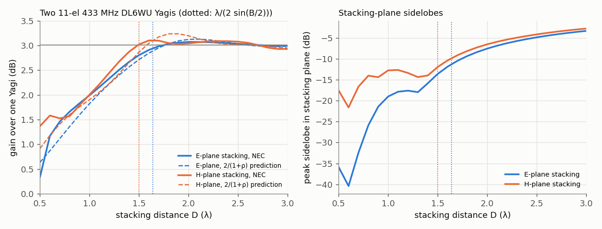

# Stacking and arraying Yagis

## Questions this page answers
- How much gain do I really get from stacking two (or four) identical Yagis — is it 3 dB?
- How far apart should stacked Yagis be, and where does the λ/(2 sin(B/2)) formula come from?
- Why do different books give different stacking distances (51/HPBW, λ/(2 sin(B/2)), "capture areas just touching")?
- Can a stack ever give more than 3 dB?
- Should I stack side by side or one above the other, and what changes with vertical vs horizontal polarization?
- How do I build a phasing harness from 75 Ω coax, and how accurately must the cable lengths match?
- What happens if one Yagi is fed upside down (reversed polarity)?
- Can I tilt a stacked pair's beam upward with a cable delay instead of tilting the booms?
- Does stacking three or four Yagis in a line give 4.8 and 6 dB?
- T-connector harness or Wilkinson power divider?
- For a rocket ground station: two stacked Yagis, one longer Yagi, or a crossed Yagi for circular polarization?
- How narrow does the beam get, and how accurately must I then point it?
- How do I scale a 433 MHz stack to 915 MHz?
- How do I measure the velocity factor of my coax to cut the harness?

## TL;DR
- **Stack gain = 2/(1 + ρ)** for two identical antennas, where ρ is the mutual-to-self radiation resistance ratio — equal to the single antenna's power pattern Fourier-transformed at the spacing. ρ > 0 (capture areas overlap) gives < 3 dB; ρ → 0 gives 3.01 dB; ρ < 0 gives slightly *more* than 3 dB. This frozen-current prediction agrees with full NEC to within 0.24 dB for D ≥ 1λ (433 MHz DL6WU study).
- **NEC, two 11-element DL6WU 433 MHz Yagis (14.31 dBi each, HPBW 35.5° E × 39.0° H)**: maximum stack gain **+3.07 dB (E-plane, 2.1λ)** and **+3.10 dB (H-plane, 1.6λ)**. At the **DL6WU/G3SEK spacing D = λ/(2 sin(B/2))** — 1.64λ = 1136 mm (E), 1.50λ = 1037 mm (H) — the gain is **+2.94 / +3.02 dB** with stacking-plane sidelobes **−11.3 / −12.0 dB**. Amateur figures of 2.5–2.9 dB include harness loss and structure.
- **Formulas trade gain for sidelobes**: λ/(2 sin(B/2)) puts the 2-element array-factor null exactly on the single Yagi's −3 dB angle. The KB Yagi page's "51/HPBW" (1.44/1.31λ) gives +2.72/+2.69 dB with −15.0/−14.3 dB sidelobes; capture-area (rectangle) 1.54/1.40λ gives +2.84/+2.87 dB. All are within 0.4 dB of the maximum; wider spacing raises the stacking lobes rapidly (−7.5 dB at 2λ, E-plane).
- **N in a line**: G_N/G₁ = N/[1 + (2/N)Σ(N − m)ρ(mD)] — NEC +3.02/+4.74/+5.99 dB for 2/3/4 Yagis at 1.5λ (H-plane), beams 17.5°/11.5°/8.5°.
- **2×2 box** at the DL6WU spacings: **+6.02 dB (20.33 dBi), 16.0° × 17.5°** — the sum of the two pair increments (separable). A single Yagi with the same +2.7 dB as a 2-stack needs a **3.61 m, 18-element** boom (16.97 dBi, 27° × 28.5°).
- **Harness**: two λ/4 (odd multiple) 75 Ω lines transform each 50 Ω Yagi to 112.5 Ω; paralleled = **56.25 Ω (SWR 1.125)**; 114 mm per λ/4 of VF-0.66 coax at 433.92 MHz; 9λ/4 branches (1026 mm, long enough to reach) still give SWR ≤ 1.31 over 425–445 MHz. **A 10 mm length mismatch only squints the beam 0.84° and costs 0.02 dB**; a **reversed feed polarity makes a difference pattern with a −200 dB boresight null** — the classic stacking blunder.
- **Ground station**: stacking narrows the beam *only in the stacking plane* (to ≈ 16–17.5°, ±4.6° pointing for 1 dB); stack in the plane where the rocket moves least (azimuth for a near-pad station). For a rolling rocket a **crossed (CP) Yagi** removes the 20.5%-of-the-time fades below −10 dB that a linear Yagi suffers, at a constant −3 dB; stack crossed Yagis if you need both.

## Intuition (no math)

**Two ears, one sound.** Two identical Yagis looking the same way receive the same wave; if their outputs are added in phase, the wanted signal adds in voltage (×2, four times the power) while the antennas' combined effective area doubles — net +3 dB of gain. That is the whole promise of stacking.

**Why not always 3 dB?** Each Yagi "collects" energy from an area around itself — its capture area, larger than the antenna itself (an 11-element 433 MHz Yagi captures about 1 m²). If you put two Yagis so close that these areas overlap, they compete for the same energy and the gain falls short of 3 dB (at half a wavelength apart you get barely +0.3 to +1.4 dB). Put them so that the capture areas just touch and you get essentially the full 3 dB. Put them farther apart and the combined beam breaks up: the pattern of a widely spaced pair is a fringe pattern (like a two-slit experiment) and the extra fringes inside each Yagi's beam become strong sidelobes.

**The fringe picture of the formula.** The two-element pattern has nulls where the path difference is half a wavelength. The DL6WU formula places the first such null exactly at the angle where the single Yagi is 3 dB down. Inside that angle the fringes reinforce the main beam; outside it the Yagi's own pattern suppresses the next fringe (sidelobe) to about −12 dB.

**Stacking narrows one plane.** Two Yagis side by side make the beam narrower side to side but not up and down. That matters for tracking: a narrow beam in the direction the target moves means more pointing effort.

**Feeding is the delicate part.** The two Yagis must be fed in phase with equal power. Equal-length cables do the phase; a quarter-wave transformer section does the impedance. Flip one Yagi (or its feed) and the two outputs cancel exactly straight ahead — you have built a monopulse difference antenna by accident.

## The math

Conventions: elements along y (horizontal polarization in the NEC model), boom along +x. **E-plane stacking** = offset along the element direction (collinear; side by side for a horizontal Yagi); **H-plane stacking** = offset perpendicular to the elements (one above the other for a horizontal Yagi). For a *vertically* polarized Yagi swap the words: vertical stacking is then E-plane (collinear). B = single-Yagi half-power beamwidth in the stacking plane.

### Level 1 — results

| Quantity | Formula | 433 MHz DL6WU 11-el (NEC) |
|---|---|---|
| Stack gain, two Yagis | G₂/G₁ = 2/(1 + ρ(D)) | max +3.07 (E) / +3.10 (H) dB |
| DL6WU / G3SEK spacing | D = λ/(2 sin(B/2)) | 1136 mm (E) / 1037 mm (H) |
| KB Yagi-page rule | D ≈ 51/B(°) λ | 995 / 905 mm |
| Capture-area spacing | D = √(A_e·B_other/B_stack), A_e = Gλ²/4π | 1063 / 968 mm (A_e = 1.03 m²) |
| Stacked beamwidth (stacking plane) | ≈ half of B | 35.5° → 16.0°; 39.0° → 17.5° |
| 2×2 box | ≈ ΔG_E + ΔG_H | +6.02 dB |
| λ/4 transformer | Z_in = Z₁²/Z_L | 75²/50 = 112.5 Ω; pair → 56.25 Ω |
| Squint from phase error δφ | sinθ_s = δφλ/(2πD) | 7.9° (10 mm) → 0.84° |
| Pointing loss | L ≈ 12(Δθ/θ₃)² dB | 16° beam: 4.6° for 1 dB |

### Level 2 — derivations

**(a) Stack gain from mutual resistance — the exact statement of "capture areas".** Two identical antennas with identical current distributions (scaled by feed currents I₁ = I₂ = I) radiate total power
$$P = |I|^2(R_{11}+R_{22}+2R_{12}) = 2|I|^2R_{11}(1+\rho),\qquad \rho = R_{12}/R_{11},$$
where R₁₂ is the mutual radiation resistance. On boresight the fields add in phase, so the power density is 4× that of one antenna fed with I (power |I|²R₁₁). Hence
$$\frac{G_2}{G_1} = \frac{4\,|I|^2R_{11}}{2|I|^2R_{11}(1+\rho)} = \frac{2}{1+\rho}.$$
For frozen currents, R₁₂ follows from the far field: R₁₂/R₁₁ = ∮P₁(Ω)cos(k**D**·r̂)dΩ / ∮P₁dΩ — the normalised **Fourier transform of the single antenna's power pattern** at spatial frequency D/λ along the stacking axis. A big (high-gain) antenna has a narrow power pattern, whose transform stays large out to large D: its capture area is large. ρ falls to zero at roughly the capture-area dimension, oscillates slightly negative beyond (gain slightly above 3.01 dB), and tends to 0 (3.01 dB) as D → ∞. Using the single Yagi's NEC power pattern, this predicts +0.64/+1.82/+2.71/+3.12/+3.03 dB at D = 0.5/1.0/1.5/2.0/2.5λ (E-plane) against full NEC +0.34/+1.99/+2.80/+3.07/+3.03 dB; maximum difference 0.17 dB (E) and 0.24 dB (H) for D ≥ 1λ (`e8_yagi_stack.py` §3). The residual is mutual coupling changing the currents (strong only below ≈ 1λ: at 0.5λ collinear the element tips are 14 mm apart and the feed impedance becomes 122 − j19 Ω). Implied ρ: +0.016 (E) and −0.002 (H) at the DL6WU spacing, −0.014/−0.021 at the gain maxima.

**(b) Where λ/(2 sin(B/2)) comes from.** With pattern multiplication the pair pattern is P₁(θ)·cos²(πD sinθ/λ). The array-factor's first null is at sinθ = λ/(2D). Setting that null at the Yagi's own half-power angle θ = B/2 gives **D = λ/(2 sin(B/2))** (DL6WU, as given by G3SEK [1]): the array factor then reinforces the main beam inside ±B/2 and the first fringe beyond falls where the Yagi is already > 3 dB down — the stacking sidelobe ends up near −11 to −12 dB (NEC −11.3 E / −12.0 H). Small-angle form: D ≈ λ/B(rad) = 57.3/B(°) λ. The "51/HPBW" rule on the [Yagi page](../08-antennas/yagi-uda-and-log-periodic.md) (attributed there to the DL6WU program) is 11% closer and moves the null outside B/2: −15.0/−14.3 dB sidelobes for 0.22/0.33 dB less gain. **The two published rules differ (flagged in the research log); both are within 0.4 dB of the maximum — choose by how much you care about the stacking lobes.** G3SEK notes the formula is for long Yagis (> 10 elements, boom > ~2λ) [1].

**(c) The capture-area (effective-aperture) estimate.** A_e = Gλ²/(4π) = 10^{1.431}·0.692²/(4π) = 1.03 m² for the 14.31 dBi Yagi. If the capture area were a uniformly illuminated rectangle, its sides would be inversely proportional to the beamwidths (HPBW = 0.886λ/L), so L_stack/L_other = B_other/B_stack and **L_stack = √(A_e B_other/B_stack)**: 1.54λ (E), 1.40λ (H) → +2.84/+2.87 dB. An ellipse of the same area and aspect ratio gives 1.73/1.58λ — essentially the DL6WU values. G3SEK's guidance — space so the capture areas just touch [1] — is the qualitative form of (a).

**(d) Stacked beamwidth and sidelobes vs spacing (NEC, E-plane):** 1.0λ: 22.5°, −19.0 dB; 1.4λ: 18.0°, −15.8 dB; 1.6λ: 16.0°, −11.8 dB; 2.0λ: 13.5°, −7.5 dB; 3.0λ: 9.0°, −3.3 dB (the "sidelobe" is now a second main lobe). H-plane is similar but its sidelobes rise earlier (−14 dB already at 0.8λ, because the wider H-plane element pattern lets the fringes through). Beyond the gain maximum there is **nothing to gain and much to lose** by spacing further (G3SEK [1]).

*Full NEC sweep* (two 11-element DL6WU Yagis, 433 MHz, free space; ΔG over one Yagi, HPBW and peak sidelobe in the stacking plane):

| D (λ) | D (mm) | E-plane ΔG | E HPBW | E sidelobe | H-plane ΔG | H HPBW | H sidelobe |
|---|---|---|---|---|---|---|---|
| 0.5 | 346 | +0.34 dB | 28.0° | −35.9 dB | +1.37 dB | 30.5° | −17.5 dB |
| 0.8 | 554 | +1.66 | 25.0° | −25.9 | +1.57 | 26.0° | −14.0 |
| 1.0 | 692 | +1.99 | 22.5° | −19.0 | +2.00 | 23.0° | −12.7 |
| 1.2 | 831 | +2.33 | 20.0° | −17.6 | +2.45 | 20.5° | −13.3 |
| 1.4 | 969 | +2.67 | 18.0° | −15.8 | +2.87 | 18.5° | −13.9 |
| 1.5 | 1039 | +2.80 | 17.0° | −13.6 | +3.02 | 17.5° | −11.9 |
| 1.6 | 1108 | +2.91 | 16.0° | −11.8 | +3.10 | 16.5° | −10.3 |
| 1.8 | 1246 | +3.03 | 14.5° | −9.3 | +3.05 | 15.0° | −8.1 |
| 2.0 | 1385 | +3.07 | 13.5° | −7.5 | +3.04 | 13.5° | −6.5 |
| 2.5 | 1731 | +3.03 | 11.0° | −4.8 | +3.08 | 11.0° | −4.1 |
| 3.0 | 2077 | +2.99 | 9.0° | −3.3 | +2.93 | 9.0° | −2.7 |



The H-plane curve has a bump at 0.6λ (+1.58 dB) and a dip at 0.8λ: close broadside Yagis couple strongly (feed impedance 40–46 Ω with +j8–11 Ω), so the frozen-current prediction is off there by up to 0.45 dB — below ≈ 1λ, trust NEC, not the formula.

**(e) Four Yagis.** A 2×2 "box" on an H-frame at the two DL6WU spacings (1136 × 1037 mm) gives 20.33 dBi = +6.02 dB over one Yagi, beam 16.0° × 17.5°, sidelobes −10.9/−11.7 dB, feed impedance 47.9 Ω — the sum of the two pair increments (+2.94 + 3.02 = 5.96 dB), as expected when the stacking directions are orthogonal (ρ factorises approximately). Four in a single line would give ≈ +6 dB too but a 4× narrower beam in one plane and higher lobes.

**(e2) N Yagis in a line — the general formula.** With equal in-phase currents on N identical antennas at spacing D, the boresight power density grows as N² and the radiated power as Σ_mΣ_n R_mn = NR₁₁[1 + (2/N)Σ_{m=1}^{N−1}(N − m)ρ(mD)], so
$$\frac{G_N}{G_1} = \frac{N}{1+\frac{2}{N}\sum_{m=1}^{N-1}(N-m)\,\rho(mD)} .$$
At the DL6WU H-plane spacing (1.50λ), NEC gives +3.02/+4.74/+5.99 dB for N = 2/3/4 (10 log N = 3.01/4.77/6.02) with stacking-plane beams 17.5°/11.5°/8.5° and lobes −11.9/−12.4/−12.6 dB; the frozen-current formula gives +2.86/+4.53/+5.74 dB (within 0.25 dB; check §6d). A 4-high line gives the same gain as a 2×2 box but a 4× narrower beam in one plane — almost never what a tracking station wants.

**(f) Phasing harness [2], [3].** Equal power and equal phase to each Yagi, matched to 50 Ω:
- *λ/4 transformers*: a line of Z₁ and electrical length λ/4 transforms Z_L to Z₁²/Z_L. With Z₁ = 75 Ω and 50 Ω Yagis each branch presents 112.5 Ω, two in parallel 56.25 Ω (SWR 1.125). Any **odd** multiple works and lets the cable reach the Yagis: at 433.92 MHz, λ/4 of VF-0.66 coax is 114.0 mm; 5/7/9 quarter waves = 570/798/1026 mm with SWR ≤ 1.20/1.25/1.31 over 425–445 MHz (longer = narrower band). With the stacked Yagis' real feed impedance (46.5 + j0.5 Ω in the H-stack) the input is 60.5 Ω (SWR 1.21).
- *Four Yagis*: two such pairs (56.25 Ω each) combined again through λ/4 of 75 Ω and paralleled: 75²/56.25/2 = 50.0 Ω.
- *Equal lengths*: a length error δL gives δφ = 2πδL/(v_fλ); the beam squints to sinθ_s = δφλ/(2πD) and the boresight loses 20 log cos(δφ/2): 5/10/30 mm → 0.42°/0.84°/2.5° squint, 0.005/0.02/0.19 dB. Cut to ±5 mm and measure electrical length with a VNA/NanoVNA.
- *Polarity*: reversing one feed (180°) turns the Σ pattern into a Δ pattern — NEC: boresight null −209 dB re one Yagi, two lobes of 15.1 dBi at ±15° elevation. Mark the hot side of every driven element/balun.
- *Reactive T vs Wilkinson/hybrid*: in a T, a detuned Yagi (75 + j30 Ω) unbalances the split by 1.76 dB and its reflection goes partly into the other Yagi. A Wilkinson (or a 90°/180° hybrid used as an in-phase divider) keeps the *incident* waves equal and dumps the reflected power into its isolation resistor — better behaviour when one antenna is iced, wet or damaged, at the cost of a part and ≈ 0.2–0.5 dB of insertion loss ([dividers](../06-rf-circuits/couplers-dividers-combiners.md)).
- *Loss*: each branch must reach at least half the spacing plus slack (≈ 0.8–0.9 m at 433 MHz): 0.24–0.25 dB in RG-58-class cable (2.9 dB/10 m), 0.07–0.08 dB in LMR-400-class (0.87 dB/10 m) ([coax](../03-transmission-lines-matching/coax-and-cables.md)). Harness loss is why measured stack gains are 2.5–2.9 dB rather than 3.0–3.1 dB.

**(g) Polarization statistics for a rolling rocket.** A linear ground antenna receiving a linearly polarized rocket antenna that rolls uniformly sees PLF = cos²ψ: mean −3.01 dB, **20.5% of the time worse than −10 dB** (exactly (2/π)·asin√0.1) and 6.4% worse than −20 dB. A CP ground antenna (crossed Yagi, [polarization](../08-antennas/antenna-polarization-and-circular-polarization.md)) receives a constant −3.01 dB. So a linear 2-stack (+3 dB) only matches a single crossed Yagi *on average*, and it fades.

**(h) Which plane narrows? — a decision table.**

| Yagi polarization | Stacked side by side (horizontal offset) | Stacked one above the other (vertical offset) |
|---|---|---|
| Horizontal (elements horizontal) | E-plane stacking → azimuth beam narrows (35.5° → 16°) | H-plane stacking → elevation beam narrows (39° → 17.5°) |
| Vertical (elements vertical) | H-plane stacking → azimuth narrows (39° → 17.5°) | E-plane stacking (collinear) → elevation narrows (35.5° → 16°) |
| Crossed (CP) | both polarizations: azimuth narrows | both polarizations: elevation narrows |

Use the beamwidth of the stacking plane in the spacing formula (E-plane: 1136 mm, H-plane: 1037 mm at 433 MHz for this design). For tracking a rocket's climb, narrow the plane the rocket moves *least* in; for an aircraft/drone at constant altitude far away, narrowing elevation is fine (and reduces ground pick-up and noise from the ground).

### Level 3 — what the free-space model leaves out
- **Ground reflection**: over ground the elevation pattern lobes (h/λ sets the lobe spacing); low-elevation tracking (rocket far away or descending) sits in the first ground lobe. Model over real ground (NEC GN 2) at your mast height. Cebik's 2 m study, done over ground, found gain-peak spacings larger than the formula and stack increments that fall with Yagi size [4].
- **Mast and frame**: metal in the capture area (H-frame crossbar in the element plane, the mast between vertically stacked vertical Yagis) detunes and scatters; keep metal perpendicular to the elements or outside the capture area [1].
- **Dissimilar or crossed stacks**: stacking crossed Yagis needs equal phasing of *both* polarizations; the CP harness (λ/4 delay) and the stacking harness are separate ([ground-station recipe](../20-projects-recipes/ground-station-tracking-yagi.md)).
- **Dissimilar Yagis**: stacking a longer and a shorter Yagi gives less than the sum; the combined aperture is limited by the smaller capture area unless the feed is weighted (unequal power split ≈ in proportion to each antenna's gain maximises the combined gain — the matched-filter rule of [array factor](array-factor-linear-arrays.md) applied to two channels).
- **Noise temperature**: a vertical stack's narrower elevation beam sees less warm ground in its lobes when the beam is raised; at UHF the system noise is usually LNA-dominated, so this matters little below ≈ 1 GHz.
- **Monopulse from a stack**: the same two Yagis feeding a 180° hybrid give Σ and Δ outputs — an amplitude-comparison monopulse tracker in the stacking plane ([radar tracking & monopulse](../11-radar/radar-tracking-monopulse-and-trackers.md), [Bayliss](array-pattern-synthesis.md)).

## Design equations & rules of thumb

| Equation / rule | When valid | Typical values (verified) |
|---|---|---|
| G₂/G₁ = 2/(1 + ρ), ρ = R₁₂/R₁₁ | identical antennas, in phase | NEC within 0.24 dB of frozen-current ρ for D ≥ 1λ |
| D = λ/(2 sin(B/2)) | long Yagis (> 10 el, > 2λ) | 11-el 433 MHz: 1.64λ E, 1.50λ H; +2.9–3.0 dB; −11 to −12 dB lobes |
| D ≈ 51/B(°) λ | lower-sidelobe compromise | +2.7 dB; −14 to −15 dB lobes |
| Max stack gain ≈ 3.0–3.1 dB at 1.6–2.1λ | lossless, free space | wider spacing → only lobes |
| 2×2 box ≈ ΔG_E + ΔG_H | orthogonal stacking | +6.0 dB |
| Same gain from one longer Yagi | DL6WU, +2.35 dB per boom doubling | +2.66 dB needs 3.61 m (2.1× boom) |
| λ/4 of 75 Ω → 56.25 Ω pair | 50 Ω antennas | SWR 1.125 centre; 9λ/4 branches ≤ 1.31 over ±10 MHz |
| Length tolerance | 433 MHz, D ≈ 1.5λ | ±10 mm → 0.84°, 0.02 dB |
| Pointing loss 12(Δθ/θ₃)² dB | Gaussian beam | 1 dB at θ₃/3.46 |
| Electrical tilt δφ = 2π(D/λ)sin θ₀ | trim only (≲ B/4) | 10° asked → 8° obtained, −0.5 dB, −4.9 dB grating lobe |
| N in a line: G_N/G₁ = N/[1 + (2/N)Σ(N−m)ρ(mD)] | identical, in phase | 4 at 1.5λ: +5.99 dB, 8.5° |
| Linear-vs-rolling-linear fade | uniform roll | 20.5% < −10 dB; CP: −3 dB constant |

## Worked examples

**Example 1 — Two 11-element 433 MHz DL6WU Yagis for a rocket ground station.** Single Yagi: 1.72 m boom, 14.31 dBi, 35.5° × 39.0°. The rocket's azimuth from a station 2–5 km from the pad changes little during ascent, the elevation a lot, so narrow the **azimuth**: for horizontal Yagis stack side by side (E-plane) at 1136 mm; for vertical Yagis (matching a vertical rocket dipole near the horizon) side by side is H-plane stacking at 1037 mm. Result: ≈ +2.9–3.0 dB in free space, minus ≈ 0.1–0.25 dB harness loss → ≈ +2.8 dB, azimuth beam 16–17.5° (hold ±4.6–5° for < 1 dB), elevation beam unchanged (36–39°). Harness: two 9λ/4 lengths (1026 mm each of VF-0.66 75 Ω coax — check *your* cable's VF with a NanoVNA) to a T, or equal 50 Ω lengths into a 2-way Wilkinson. In range terms, +2.8 dB is ×1.38 range in free space — worthwhile for a long-range flight, irrelevant for a 3 km hop with 25 dB of margin ([link budget](../15-lora-ism-radios/lora-sensitivity-and-link-budget.md)).

**Example 2 — Stack, or one long Yagi?** Same +2.7 dB: an 18-element DL6WU on a 3.61 m boom (16.97 dBi, 27° × 28.5°) narrows *both* planes moderately and needs one feed and no harness, but it is a 3.6 m boom to hand-track. Two 1.72 m Yagis on a 1.1 m frame narrow only one plane (to 16°), keep the other at 39°, and need a harness. For tracking a rocket's climb (elevation) a side-by-side stack is easier to follow than a long Yagi; for a fixed station pointing at the expected apogee, the long Yagi's wider azimuth beam (27° vs 16°) is more forgiving.

**Example 3 — Stack, or a crossed Yagi?** A linear 2-stack gives 17.2–17.3 dBi on boresight but, against a rolling linear rocket antenna, fades below −10 dB 20.5% of the time. A single crossed 11-element Yagi gives a steady 14.3 dBic − 3 dB ≈ 11.3 dB effective with no roll fades. Four Yagis as two stacked crossed pairs give ≈ 14.3 dB effective and steady — the professional answer (helices or CP arrays at telemetry ranges) at four times the hardware. If budget allows only two Yagis, **cross them rather than stack them** for a rolling rocket ([ground-station design](../15-lora-ism-radios/ground-station-design.md)).

**Example 3b — The link-budget view (433.92 MHz, apogee 10 km, station 2 km from the pad).** Slant range 10.2 km → FSPL 20 log(4πRf/c) = 105.4 dB. Singapore licence-exempt 10 mW into the rocket's axial dipole, seen 11° off its axis (≈ −14 dBi, [antennas on rockets](../08-antennas/antennas-on-rockets.md)) → EIRP toward the station ≈ −4 dBm. LoRa SF9/125 kHz sensitivity ≈ −129 dBm ([link budget](../15-lora-ism-radios/lora-sensitivity-and-link-budget.md)).

| Ground antenna | Effective gain incl. polarization | Received | Margin | Roll behaviour |
|---|---|---|---|---|
| 11-el linear Yagi | 14.31 − 3.01 (mean PLF) | −98.1 dBm | 30.9 dB (mean) | 20.5% of the time ≥ 10 dB below the aligned value, 6.4% ≥ 20 dB |
| 2 linear, stacked (harness −0.25 dB) | 17.25 − 3.01 − 0.25 | −95.4 dBm | 33.6 dB (mean) | same fades |
| 11-el crossed (CP) | 14.31 − 3.01 (constant) | −98.1 dBm | 30.9 dB | steady |
| 2 crossed, stacked | 17.33 − 3.01 − 0.25 | −95.3 dBm | 33.7 dB | steady |

With ≈ 31 dB of margin the stack's +2.7 dB matters less than removing the fades; the order of upgrades for a rolling rocket is **CP first, stacking second** (or a longer boom), and LNA-at-the-antenna before either ([ground-station design](../15-lora-ism-radios/ground-station-design.md)). Stacking earns its place for high-altitude or long-range flights where the margin is single-digit dB.

**Example 4 — Checking a harness on the bench.** NanoVNA at the harness input with both Yagis connected and pointed at the sky: expect |S₁₁| ≈ −18 to −25 dB (SWR 1.12–1.25). Disconnect one Yagi and terminate its branch in 50 Ω: S₁₁ changes, but the remaining Yagi should still show a good match through its branch. To check phase, measure each branch's S₂₁ phase (via a 50 Ω through) — differences ≤ 4° at 433 MHz (≤ 5 mm). A beam that peaks off boresight by ≈ 1° per 10 mm of mismatch confirms a length error; a deep null on boresight confirms a reversed feed.

**Example 5 — Scaling to 915 MHz.** Spacings scale with λ *for the same electrical design*: λ = 327.6 mm, so the 11-element DL6WU (0.82 m boom, ≈ 14.3 dBi on the [Yagi page](../08-antennas/yagi-uda-and-log-periodic.md)) stacks at ≈ 1.64λ = 537 mm (E-plane) or 1.50λ = 491 mm (H-plane). A λ/4 of VF-0.66 coax is 54.1 mm; 11λ/4 = 595 mm reaches a Yagi 0.27 m from the T with slack. Length tolerance scales too: ±5 mm at 915 MHz is ≈ 8° of phase (squint ≈ 0.8°) — twice as tight in millimetres as at 433 MHz.

**Example 6 — Electrically tilting a vertical stack (and why not to).** Two horizontal Yagis one above the other at 1037 mm (1.50λ) with booms level; delay the *upper* Yagi's feed by δφ = 2π(D/λ)sin(tilt) to raise the beam. NEC: asking for 5° (47°, 60 mm of extra VF-0.66 cable) gives a peak at +4.0° and 17.20 dBi; 10° (94°, 119 mm) gives +8.0°, 16.79 dBi (−0.5 dB) and a −4.9 dB grating lobe at −21.5°; 20° (184°) splits the beam into two nearly equal lobes at −14.8° and +15.5° (useless). The single Yagi's own pattern pulls the peak back toward its boresight, and the array factor's grating lobe (at sinθ_g = sinθ₀ − λ/D) moves into the element beam. **Tilt mechanically; use the phase step only for a few degrees of trim.** For phase-steered tracking you need closer spacing (smaller D, less gain) or many elements — a [phased array](diy-phased-array-projects.md).

*Harness build procedure (2 Yagis):*
1. Match each Yagi to 50 Ω on its own (balun, gamma or folded dipole + 4:1 balun) and mark the feed polarity.
2. Measure the VF of the 75 Ω cable: open-ended stub, find the first S₁₁ resonance on a NanoVNA, VF = 4·L·f_res/c.
3. Choose the smallest odd n with n·λ/4·VF ≥ D/2 + slack; cut both branches to the same length ±5 mm (433 MHz).
4. Join at a T (N-type preferred), or use equal 50 Ω cables into a 2-way Wilkinson.
5. Verify: input SWR ≤ 1.25 over the band; branch phases equal within 4°; on air, peak on boresight and no boresight null.

```
   Yagi A (50 Ω) ──── n·λ/4 of 75 Ω ────┐
                                          T ── 56 Ω ── 50 Ω feeder ── LNA/radio
   Yagi B (50 Ω) ──── n·λ/4 of 75 Ω ────┘     (n odd, both branches equal)
```

## Practical notes
- **Mechanics**: an H-frame of non-conducting tube (fibreglass) for the crossbar, or a metal crossbar perpendicular to the elements; booms clamped at their balance point; the coax harness routed along the boom back, away from elements.
- **Matched Yagis first**: harness math assumes each Yagi is matched (≈ 50 Ω). DL6WU designs with folded dipoles need their 4:1 baluns *before* the harness.
- **Real cable VF varies 0.66–0.85** (solid PE, foam, PTFE): always cut λ/4 lengths from a measured VF, not the catalogue value.
- **Waterproof the T and connectors**: water in one branch shifts its phase and impedance.
- **Do not stack wider than the gain maximum** — it adds only lobes, mechanical size and wind load.
- **Beam pointing**: with a 16° stack beam, GNSS-telemetry pointing (az/el from downlinked position) or a rotator is advisable ([ground-station recipe](../20-projects-recipes/ground-station-tracking-yagi.md)).

- **Rotator and wind**: two 1.7 m booms on a 1.1 m H-frame present roughly twice the wind area of one Yagi at the rotator; size the rotator and mast clamp for it, and balance the frame about the mast.
- **Receive-only stacks** can put an LNA at each Yagi before the combiner: harness loss then no longer costs noise figure, but the two LNAs must be gain- and phase-matched (they become part of the "harness" phase budget) — this is a 2-element phased array ([beamforming architectures](beamforming-architectures.md)).

## Common mistakes & misconceptions
- **"Stacking always gives 3 dB."** 0.3–1.4 dB at λ/2, ≈ 2 dB at 1λ, ≈ 3 dB only near the optimum; minus harness loss.
- **"More spacing = more gain."** Gain peaks at 1.6–2.1λ (for this Yagi) and then falls slowly while the stacking lobes rise to near the main-beam level (−3.3 dB at 3λ).
- **"λ/(2 sin(B/2)) and 51/HPBW are the same rule."** They differ by 11–14%; one maximises gain more, the other gives lower lobes. Know which you are using.
- **Using the wrong beamwidth**: use the beamwidth in the *stacking* plane (E-plane for collinear stacking, H-plane for broadside stacking).
- **Reversed feed on one Yagi** → boresight null (difference pattern). Mark the hot side of every feed.
- **Even multiples of λ/4** for the transformer branches — a λ/2 section reproduces 50 Ω and the T gives 25 Ω (SWR 2).
- **Forgetting cable VF** when cutting λ/4 sections.
- **Stacking linear Yagis for a rolling rocket** and blaming the radio for the 20%-of-the-time fades — use CP.
- **Expecting a 4-high line to behave like a 2×2 box**: same gain (+6 dB), but an 8.5° beam in one plane.
- **Trusting the 2/(1+ρ) formula below 1λ**: mutual coupling changes the currents; NEC differs by up to 0.45 dB at 0.5λ.
- **Metal H-frame crossbar in the element plane** inside the capture area — detuning and pattern distortion.

## How to simulate / verify
- `python3 tools/verify/e8_yagi_stack.py` (PyNEC, ~5 s, **ALL PASS**): DL6WU 11-element 433 MHz Yagi (from `ant_yagi.dl6wu_design`, DE resonated in NEC), energy check; 2-stacks 0.5–3.0λ in both planes (gain, beamwidth, lobes, impedance); frozen-current ρ prediction; formula spacings; 2×2 box; longer single Yagis; harness SWR vs frequency and branch length; squint/loss from length errors; reversed polarity; T vs Wilkinson; polarization fade statistics. Output in `tools/verify/e8_yagi_stack_output.txt`.
- NEC tips used here: 13 segments per element (λ/27, dA ≈ 8.6), multiple EX cards add sources; read results while the `nec_context` is alive; the NEC2++ average-gain test needs a φ grid that does not start on the main beam ([NEC modelling](../16-simulation-tools/nec-antenna-modelling.md)).
- Minimal PyNEC skeleton for a 2-stack (elements along y, boom along x, second Yagi offset by D in z):
  ```python
  import PyNEC
  c = PyNEC.nec_context(); g = c.get_geometry(); tag = 0; feeds = []
  for dz in (-D/2, D/2):
      for i, (L, x) in enumerate(zip(lengths, positions)):      # metres; element 1 = driven element
          tag += 1; g.wire(tag, 13, x, -L/2, dz, x, L/2, dz, 0.003, 1.0, 1.0)
          if i == 1:
              feeds.append(tag)
  c.geometry_complete(0); c.gn_card(-1, 0, 0, 0, 0, 0, 0, 0)
  for t in feeds:
      c.ex_card(0, t, 7, 0, 1.0, 0, 0, 0, 0, 0)                 # equal in-phase 1 V sources (centre segment 7 of 13)
  c.fr_card(0, 1, 433.0, 0)
  c.rp_card(0, 1, 1, 0, 0, 0, 0, 90.0, 0.0, 0, 0, 0, 0)          # boresight (+x) gain
  print(c.get_radiation_pattern(0).get_gain())                  # read while c is alive
  ```
- Field check: measure received power from a distant beacon vs pointing with one Yagi, then the stack (same coax) — expect +2.5 to +3 dB and a narrowed beam in one plane only ([antenna measurement](../08-antennas/antenna-measurement.md)).

## Open questions / gaps
- All results are free-space; stacks over real ground at a realistic mast height (and the mast/H-frame itself) are not modelled.
- The ARRL Antenna Book stacking chapter and the DJ9BV/K7MEM stacking-distance papers were not read (only G3SEK's page read in full; Cebik via a WebFetch summary, CONVENTIONS rule 8 — treat his numbers as indicative).
- Crossed-Yagi stacks (CP + stacking harness together) and dissimilar-band stacking are described, not simulated.
- Electrical tilt and unequal (gain-weighted) feeding of dissimilar Yagis were simulated only for the identical 11-element pair.
- The origin of the "51/HPBW" constant on the KB Yagi page was not traced to a primary DL6WU source.

## Sources
1. I. White (G3SEK), "Stacking Yagi antennas," VHF/UHF Long Yagi Workshop, ifwtech.co.uk/g3sek/stacking/stacking2.htm (updated 2009) — capture areas that just touch, 2.5–2.9 dB for two, DL6WU formula D = λ/(2 sin(B/2)) for long Yagis, vertical stacking narrows elevation and adds elevation lobes, H-frame interaction. (amateur engineering literature; READ)
2. ARRL, *The ARRL Antenna Book*, 24th ed., 2019, VHF/UHF antenna systems chapter — stacking, phasing harnesses with λ/4 sections. (handbook — amateur engineering literature; cited, not read)
3. D. M. Pozar, *Microwave Engineering*, 4th ed., Wiley, 2012, §2.5 quarter-wave transformer, §7.3 Wilkinson divider. (textbook; cited)
4. L. B. Cebik (W4RNL), "2-meter Yagi stacks, part 1: 6- to 18-element OWA examples," antenna2.github.io/cebik/content/vhf/2mstack.html — NEC over ground: stack increments 2.9 dB (6 el) to 2.2 dB (18 el), gain-peak spacings 1.0–2.4λ exceeding the RSGB/DL6WU formula. (expert amateur article; WebFetch summary only)
5. G. Hoch (DL6WU), long-Yagi design data and DL6WU.BAS (via [Yagi page](../08-antennas/yagi-uda-and-log-periodic.md)) — design used here, gain estimate 9.2 + 3.39 ln(boom/λ) dBd. (amateur engineering literature)
6. R. Bertelsmeier (DJ9BV), "Optimum stacking distances," *DUBUS*; K7MEM stacking-distance calculator — same λ/(2 sin(B/2)) form. (amateur engineering literature; search summaries only)
7. C. A. Balanis, *Antenna Theory*, 4th ed., Wiley, 2016, ch. 8 (mutual impedance) and ch. 6 (pattern multiplication). (textbook; cited)
8. `tools/verify/e8_yagi_stack.py` and `e8_yagi_stack_output.txt` — every NEC number on this page. (own verification)
